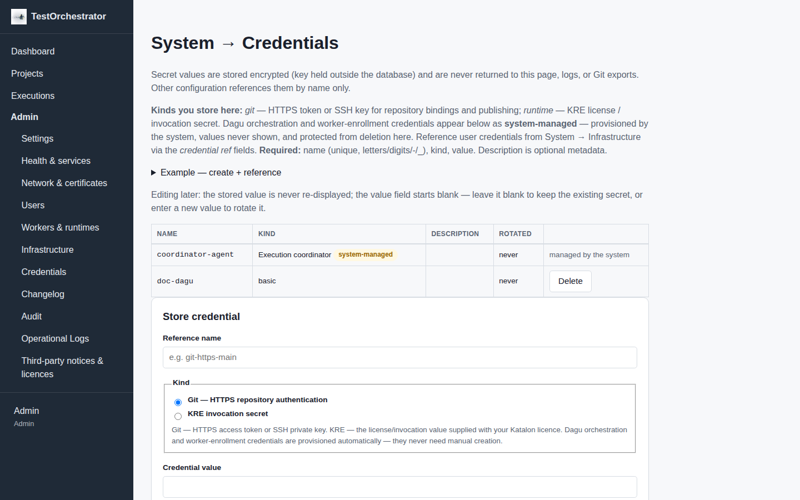
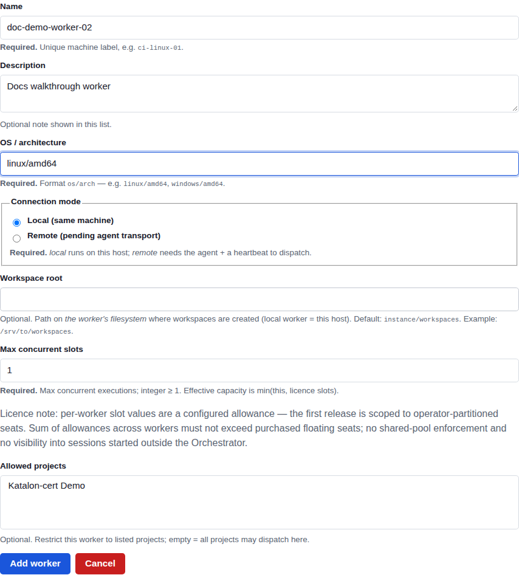

# TestOrchestrator 2.0.2 — Administrator Manual

Applies to released **TestOrchestrator 2.0.2** (tag `v2.0.2`, source
commit `574860d08124411692b141643da0ad87e576100d`).

Procedures marked **[verified]** were executed against the published
release package in an isolated Linux installation — details in
[Validation-Record.md](Validation-Record.md). Procedures marked
**[code/CI]** are documented from the installer code and CI evidence
only and were not interactively validated here.

---

## 1. Architecture and components

```
 Browser ──HTTPS──▶ Caddy (reverse proxy, TLS) ──HTTP loopback──▶ Waitress (Flask app :18080)
                                                                    │  SQLite instance dir
                                                                    ▼
                                                     portal ──API──▶ Dagu coordinator
                                                                    (start-all: UI/API + gRPC :50055)
                                                                        │ worker task poll
                                                                        ▼
                                                     dagu worker (labels: kre=<label>, os, arch)
                                                                        │ executes
                                                                        ▼
                                                     KRE (katalonc) → Reports/ → results back
```

| Piece | Ships as | Notes |
|---|---|---|
| Portal | Python 3.12 payload + offline venv | Flask/Waitress; SQLite (Alembic-migrated) in the instance dir |
| Dagu coordinator + worker | Bundled Dagu **2.27.0** binaries | Coordinator serves UI/API + gRPC; workers poll it for tasks |
| Caddy | Bundled binary | Optional-but-supported HTTPS terminator; the app renders/validates its config with rollback |
| reportingLabs | Vendored package `reporting_labs` (MIT) | Generates per-execution HTML reports |
| KRE | **Not shipped** | Install/license it on each execution host yourself |

### What an install places on the host

A supported install (tarball `install.sh` / `.run`, or the Windows
installer) creates three trees plus service definitions:

| Location | Contents |
|---|---|
| **Payload** (`--payload`, default under the install root) | Application source (`testorchestrator/`, `wsgi.py`), `3rdparty/` (bundled `python-runtime`, `python-wheels`, `git`, Dagu archives, `reporting_labs` — **since 2.0.3 at `3rdparty/reporting_labs`**, Caddy), the app `venv/` built offline from the bundled wheels, `requirements.txt`, licences |
| **Config** (`--config`) | `web.env` (service settings — not secrets), `Caddyfile`, `dagu/server.yaml` + `dagu/credentials` (0600), staged systemd units (`testorchestrator-web`, `-worker`, `-dagu`, `-caddy`) |
| **Data** (`--data`) | SQLite instance DB (Alembic-migrated on upgrade), `dagu/dags/` workflow definitions, `evidence/` per-execution artifacts, `certs/`, `logs/`, `workspaces/` per-run checkouts |

Services: `testorchestrator-web` (Waitress :18080 loopback),
`testorchestrator-caddy` (HTTPS terminator), `testorchestrator-dagu`
(coordinator: UI/API + gRPC), `testorchestrator-worker` (local agent
launcher). On a host without systemd, `--no-service-start` stages the
units only — start the processes manually with the same config files.

### Data flow

**Live execution:**

```
 you → portal (HTTPS via Caddy)
       │  creates Execution + OutboxEvent (SQLite)
       ▼
 portal dispatcher → dagu coordinator (gRPC :50055)
       │  task claimed by the worker whose labels match
       │  (kre=<label>, os, arch — from the runtime's worker_label)
       ▼
 dagu worker → katalonc (KRE) inside the binding worktree
       │  JUnit XML / logs / screenshots → Reports/
       ▼
 portal collects results → TestResult rows + evidence/<exec-id>/
       │  reporting_labs renders → evidence/.../reporting-labs/gen-*/
       ▼
 report + artifacts served through the portal (auth-checked)
```

**Historical-result import** follows the same storage path minus the
worker: preview classifies repo results → confirm writes executions,
results, and imported evidence → the same report/evidence views serve
them. Evidence that never reached the repository cannot be recreated
(see User Manual §6).

## 2. Platforms and prerequisites

### 2.1 Linux

- x86-64 Linux with glibc; the package is fully self-contained —
  **no system Python, pip, or network needed at install time**
  (bundled runtime + vendored wheels).
- Root (or sudo) only for system-wide installs under
  `/opt`/`/var/lib`/`/etc` + systemd units. A non-root user can run
  the entire payload with `--no-service-start` and explicit
  `--payload/--data/--config` directories.
- Outbound reachability to your Git hosting for bindings/imports.
- `git` is not required on the host — a pure-Python backend
  (dulwich) handles clone/fetch/checkout.

### 2.2 Windows

- Windows amd64, installed via `testorchestrator-2.0.2-windows-amd64-setup-UNSIGNED.exe`;
  worker via `testorchestrator-dagu-worker-2.27.0-setup-UNSIGNED.exe`.
- **[code/CI]** Documented from installer code + CI jobs
  (`windows-installer` workflow: compile, installed-validate,
  upgrade-from-v102, upgrade-from-v200). **No local Windows install
  or interactive test was performed for this manual**, and both
  installers are **unsigned** — expect SmartScreen warnings and plan
  your own signing/trust policy before production rollout.

## 3. Package selection and verification

Download from the GitHub release `v2.0.2`:

| Asset | Use |
|---|---|
| `testorchestrator-2.0.2-linux-x86_64.tar.gz` | Linux payload + installer |
| `testorchestrator-2.0.2-linux-x86_64.run` | Self-extracting variant of the same payload |
| `testorchestrator-2.0.2-windows-amd64-setup-UNSIGNED.exe` | Windows app installer (**unsigned**) |
| `testorchestrator-dagu-worker-2.27.0-setup-UNSIGNED.exe` | Windows worker installer (**unsigned**) |
| `SHA256SUMS.txt` | Checksums, one entry per binary |
| `build-manifest-linux.json` / `build-manifest-windows.json` | Provenance: source commit, `dirty` flag, tool versions |

Verify before installing **[verified]**:

```bash
curl -LO https://github.com/IT-Space-2026/TestOrchestrator/releases/download/v2.0.2/SHA256SUMS.txt
curl -LO https://github.com/IT-Space-2026/TestOrchestrator/releases/download/v2.0.2/testorchestrator-2.0.2-linux-x86_64.tar.gz
sha256sum -c SHA256SUMS.txt --ignore-missing
# testorchestrator-2.0.2-linux-x86_64.tar.gz: OK
```

Expected digests (from the release record):

```
af08a60d1506b061edd1342169aded75553dbc3ee6b134df23c19ec7670a6f7e  ...-linux-x86_64.tar.gz
2a5ecff4f17e66f315f3d4d7ac4eb30b0572f420a193ab71623da3f313d4a0a6  ...-linux-x86_64.run
fabb75fbd5373e4f76cc7d68d69e3f5ec53eb97a693c6e25bba1bfc0e5814814  ...-windows-amd64-setup-UNSIGNED.exe
f212af46ceb7c0cc121ac7fedf0d7f35f0c57c3efff49848547f2675de84e062  ...-dagu-worker-2.27.0-setup-UNSIGNED.exe
```

The manifests pin the exact source commit
(`574860d08124411692b141643da0ad87e576100d`, `dirty=false`) and the
bundled Dagu version (`2.27.0`).

## 4. Linux installation

### 4.1 Requirements

- A licence code (`TO1.…`) issued for this product — validated by the
  installer **before** anything is copied; a rejected code leaves no
  partial install. Unattended installs pass it via the
  `TO_LICENCE_CODE` environment variable (it is never logged).

### 4.2 Tarball install **[verified]**

```bash
tar -xzf testorchestrator-2.0.2-linux-x86_64.tar.gz
cd testorchestrator-2.0.2-linux-x86_64

# interactive: prompts for the licence code
sudo bash install.sh

# or unattended, explicit directories, units staged but not started:
TO_LICENCE_CODE='TO1.…' bash install.sh \
    --payload /opt/testorchestrator \
    --data /var/lib/testorchestrator \
    --config /etc/testorchestrator \
    --https-port 443 --http-port 8080 \
    --no-service-start --yes
```

What the installer does, in order **[verified — every step observed]**:

1. Validates the licence offline (Ed25519) against the bundled
   `release/licence_pubkey.pem`; rejects expired/not-yet-valid codes.
2. Writes `licence.json` into the data dir.
3. Copies the payload (`testorchestrator/`, `wsgi.py`,
   `requirements.txt`, `release/`, `3rdparty/`, `migrations/`,
   `deploy/`, `scripts/`).
4. Creates the offline venv from the bundled Python + vendored wheels.
5. Provisions Dagu: binary + `server.yaml` (basic auth) +
   `credentials` file (`0600`) + execution workflow + a systemd unit
   under `config/dagu/`. Set `TO_DAGU_PROVISION_PASSWORD` beforehand
   so the coordinator credential matches what the portal stores; if
   unset, a random token is generated and the installer warns — store
   that token in the portal under **Admin → Credentials** afterwards.
6. Stages systemd units (`testorchestrator-web`, `-worker`, `-dagu`,
   `-caddy`) and a `Caddyfile` under the config dir. With root +
   systemd and no `--no-service-start`, they are enabled and started;
   otherwise they are left for manual activation.

> **Known limitation of the released 2.0.2 payload copy** — the copy list
> above omits `reporting_labs/` (the vendored report generator), so
> an `install.sh`-installed 2.0.2 system cannot generate reports until
> the workaround in §10 is applied. **Fixed in 2.0.3:** the
> package lives at `3rdparty/reporting_labs`, arrives via the
> `3rdparty` copy item, and the installer fails loudly if any required
> payload file is missing.

Other `install.sh` flags: `--dry-run` prints the plan;
`--service-user` overrides the unit user.

### 4.3 The `.run` self-extracting package

`testorchestrator-…-.run` wraps the same tarball; it extracts and
invokes the installer with the same options. Verify its checksum the
same way, then run it with `bash <file>.run` (or make it executable).
The payload it produces is byte-identical to the tarball's.

### 4.4 First startup and bootstrap **[verified]**

With staged units enabled the flow is automatic. For a manual/
non-systemd start (what a dev or doc install uses):

```bash
export TO_INSTANCE_DIR=/var/lib/testorchestrator
export TO_SECRET_KEY=$(python3 -c 'import secrets; print(secrets.token_hex(32))')
/opt/testorchestrator/venv/bin/python -m testorchestrator db-upgrade   # apply schema migrations
/opt/testorchestrator/venv/bin/flask set-admin-password '<strong-password≥12>'   # headless bootstrap
/opt/testorchestrator/venv/bin/waitress-serve --listen=127.0.0.1:18080 --threads=8 wsgi:app
```

- On a fresh install the first request lazily creates the bootstrap
  `Admin`/`Admin` account. Interactive bootstrap: sign in as
  `Admin`/`Admin` — the app forces a password change before anything
  else. Headless bootstrap: `flask set-admin-password` (≥12 chars)
  sets it and marks setup complete.
- `TO_SECRET_KEY` **must** be stable across processes or sessions
  invalidate on restart — put it in `web.env`.
- `toctl db-upgrade` applies pending Alembic migrations; it is
  idempotent and safe before every start/upgrade.

### 4.5 Directory layout **[verified]**

| Path (default / this doc install) | Contents |
|---|---|
| `--payload` `/opt/testorchestrator` | Code, bundled runtime/wheels, `release/` (version, pubkey), `venv/`. Replaceable wholesale on upgrade. |
| `--data` `/var/lib/testorchestrator` | Instance dir: `testorchestrator.db`, `certs/`, `licence.json`, `bindings/` (worktrees), `imported-evidence/`, `import-staging/`, `remote-runs/`, `agent-work/`, `dagu/` (DAGU_HOME). **This is the state — back it up.** |
| `--config` `/etc/testorchestrator` | `web.env`, `Caddyfile`, `dagu/` (server.yaml, credentials, unit), staged systemd units. |
| `data/dagu` vs `config/dagu` | Runtime state/DAGs vs provisioned binary+config+credentials. |

`TO_INSTANCE_DIR` points the app at the data dir; `TO_DATABASE_URI`,
`TO_CERT_DIR`, `TO_CADDY_BIN`, `TO_CADDY_CONFIG_DIR` override
individual locations.

### 4.6 Ports and network flows

| Flow | Default | Configure |
|---|---|---|
| Browser → Caddy | 443 / http 8080 | `--https-port`/`--http-port`; **Admin → Network & certificates** renders the real Caddyfile (staged apply + `previous_good` rollback) |
| Caddy → Waitress | `127.0.0.1:18080` | unit `ExecStart` / `waitress-serve --listen` |
| Portal → Dagu API | `http://<host>:8096` | setting `dagu_endpoint` |
| Worker → coordinator gRPC | `<host>:50055` | setting `dagu_coordinator_url`; worker flag `--worker.coordinators` |
| Worker health | `:8092` | `--worker.health-port` (`0` disables) |

Access gates (bootstrap.py): every request must arrive under a
configured host alias (403 otherwise); until setup is complete **and**
`external_enabled` is set, only loopback clients may connect; a
bootstrap session is confined to the password-change form until the
temporary credential is replaced. Set `advertised_base_url` to the
public URL before enabling external access.

### 4.7 Service management and logs

```bash
systemctl enable --now testorchestrator-web testorchestrator-worker \
    testorchestrator-dagu testorchestrator-caddy
journalctl -u testorchestrator-web -u testorchestrator-worker \
    -u testorchestrator-dagu -u testorchestrator-caddy -f
```

- `testorchestrator-worker` runs the dispatch loop
  (`flask worker`); without it, queued executions never dispatch.
- In-app observability: **Admin → Health & services** (per-service
  status), **Admin → Operational Logs** (application log, export,
  tail), **Admin → Audit** (recorded administrative/security events),
  **Admin → Changelog** (upgrade history).
- `toctl readiness` probes the health endpoint on the configured port.


### 4.8 Uninstall

Stops to take, in order:

1. `systemctl disable --now testorchestrator-web …` (all four units),
   remove the unit files; stop any manually started
   coordinator/worker processes.
2. Remove the **payload** directory — that removes the application
   only.
3. The **data** and **config** dirs contain all state (database,
   evidence, licences, secrets key, credentials). Delete them only if
   you mean to destroy the installation's history; keep them for a
   reinstall or archive them first.

Removing the payload never deletes data; deleting data is always an
explicit separate step.

## 5. Windows installation **[code/CI — not locally validated]**

From the installer (`app-installer.nsi`, `build_app_installer.sh`,
`packaging/windows/`):

- `testorchestrator-2.0.2-windows-amd64-setup-UNSIGNED.exe` lays down
  the embedded-Python payload, `toctl.exe`, and the same
  `toctl install`/`toctl web` entry points (`python -m
  testorchestrator` equivalent on source layouts). Follow the
  installer's prompts; the app data lives in the configured instance
  location.
- `testorchestrator-dagu-worker-2.27.0-setup-UNSIGNED.exe` installs
  the Dagu worker binary; register labels and the coordinator
  address per §6.
- **Both installers are unsigned.** Windows will warn; verify the
  published SHA-256 before running, and sign them internally if your
  policy requires it.
- Windows CI proves compile + installed validation + upgrades
  (v1.0.2→, v2.0.0→); interactive Windows use was **not** validated
  for this manual.

## 6. Workers — installation and operation (Linux) **[verified end to end]**

### 6.1 Get the worker archive through the portal

The portal serves the pinned worker build to authenticated users —
this is the supported way to obtain it (it guarantees the worker
version matches the coordinator pin):

```
GET /system/infrastructure/dagu-worker/dagu_2.27.0_linux_amd64.tar.gz
```

```bash
curl -L -b cookies.txt -o dagu_2.27.0_linux_amd64.tar.gz \
    https://<portal>/system/infrastructure/dagu-worker/dagu_2.27.0_linux_amd64.tar.gz
```

### 6.2 Verify the asset **[verified]**

The pinned digest is published in the build manifest / release notes:

```bash
sha256sum dagu_2.27.0_linux_amd64.tar.gz
# a9045768c9777d0b938585696e0491bc0ce46fbeb0419989b34fde63a0cc6f85 (2.0.2 pin)
tar -xzf dagu_2.27.0_linux_amd64.tar.gz -C /opt/dagu-worker
/opt/dagu-worker/dagu version     # → 2.27.0
```

### 6.3 Configure the coordinator

On the portal host **[verified]**:

- `scripts/provision_dagu.py` (run by `install.sh`) writes
  `config/dagu/` containing: `dagu` binary, `server.yaml`
  (`auth.mode: basic` + credential), `credentials` (`0600`,
  `username=`/`password=`), the execution DAG in
  `data/dagu/dags/testorchestrator-execution.yaml`, and a systemd
  unit.
- Start it (unit, or manually — note `DAGU_HOME`, a private `TMPDIR`
  so Dagu's `$TMPDIR/dagu` temp dir cannot collide with stray files,
  and `--coordinator.advertise` when the hostname does not resolve
  to a bound address):

```bash
DAGU_HOME=/var/lib/testorchestrator/dagu TMPDIR=/var/lib/testorchestrator/dagu-tmp \
  /etc/testorchestrator/dagu/dagu start-all \
  --host 127.0.0.1 --port 8096 \
  --coordinator.host=127.0.0.1 --coordinator.port=50055 \
  --coordinator.advertise=<reachable-addr> \
  --config /etc/testorchestrator/dagu/server.yaml \
  --dags /var/lib/testorchestrator/dagu/dags
```

- Portal settings (**Admin → Settings** or DB):
  `dagu_endpoint` (coordinator http URL), `dagu_coordinator_url`
  (host:grpc-port), `dagu_username`, `dagu_credential_ref` — a
  Credentials entry holding the coordinator basic-auth token, and the
  opt-in `dagu_mandatory` toggle when remote dispatch should be
  required rather than best-effort.

### 6.4 Register the worker

On the worker host **[verified]**:

```bash
TMPDIR=/var/lib/dagu-worker/tmp \
  /opt/dagu-worker/dagu worker \
  --worker.id=worker-01 \
  --worker.labels="kre=api" \
  --worker.coordinators=<portal-host>:50055 \
  --worker.health-port=8092
```

- `--worker.labels` are the capabilities the portal matches against
  (`kre=<label>`); `os`/`arch` labels are added automatically.
- Registration is verified from the coordinator API or the portal's
  **Admin → Infrastructure** view (`/api/v1/workers` lists id,
  labels, health, version):

```bash
curl -u <coord-user>:<coord-pass> http://127.0.0.1:8096/api/v1/workers
```


### 6.5 Register the KRE installation on the worker

**Admin → Infrastructure → KRE installations → Register**: give the
connection a name, select the runner/worker, set the **executable
path** *as it exists on the worker* (e.g.
`/opt/kre/katalonc`), the **workspace root** the worker may use, and
the `worker_label` that selects it. The portal's *Check* probes the
executable on the portal host by default — for remote runtimes the
page itself states that remote availability is **not** verified
end-to-end; a remote check shows `Remote — not verified`. Keep the
executable's licence/API key on the worker (KRE `-apiKey` / offline
licence) — the portal cannot license it for you.

### 6.6 Dispatch a controlled demonstration job **[verified]**

Queue a suite run choosing the remote runner + runtime; the portal
dispatches with `worker_selector = {kre: <label>}`, the worker
executes `prepare → checkout → run_kre → collect`, and results
(JUnit, logs, screenshots, `execution.uuid`) return portal-side into
`remote-runs/<execution-id>/`. The execution page shows the worker,
the dagu run, and the returned artifacts.

### 6.7 Logs, stop, restart, removal

- Coordinator log: the unit's journal, or the file you redirect
  `start-all` output to. Worker log: same, on the worker host; the
  worker-side run log is also returned as an execution artifact.
- Stop a worker by terminating its process; drain it first via
  **Drain worker** (Infrastructure) so it stops accepting new tasks.
- Restart is a fresh `dagu worker` with the same `--worker.id` —
  labels and id must be stable for selection to keep working.
- Removing a worker: drain, stop the process, remove its install
  dir. In-flight executions on it will fail as infrastructure
  failures; finished ones are unaffected.

### 6.8 Windows worker **[code/CI]**

Install `testorchestrator-dagu-worker-2.27.0-setup-UNSIGNED.exe`
(**unsigned**), then run the same `dagu worker` invocation (Windows
flags identical: `--worker.id`, `--worker.labels`,
`--worker.coordinators`) pointed at the coordinator. Not
interactively validated here.

## 7. Security and administration

### 7.1 Users and roles **[verified]**

**Admin → Users**: create users with role Admin / Test Manager /
Tester / PO and a temporary password (≥12 chars, must be replaced at
first sign-in); reset or deactivate accounts. Passwords are
argon2-hashed; a session-version counter invalidates sessions on
credential change.


### 7.2 Secrets **[verified]**

**Admin → Credentials** stores `git` (HTTPS token / SSH key) and
`runtime` (KRE licence / invocation secret) values. Values are
encrypted at rest with a key held *outside* the database
(`secret.key` in the instance dir — protect and back it up), are
never re-displayed, never logged, and never exported; bindings and
runtimes reference them by name only. Dagu coordinator and
worker-enrollment credentials are **system-managed** — provisioned by
the platform (`coordinator-agent`) and protected from deletion.



### 7.3 Worker authentication

Portal↔coordinator API calls authenticate with the provisioned basic
credential (§6.3). Worker processes authenticate their coordinator
connection with the system-managed `coordinator-agent` credential;
**Issue token** on the Infrastructure page issues worker enrollment
tokens for `agent`-mode connections.

### 7.4 File permissions and TLS

- The installer writes `credentials`, `server.yaml`, `licence.json`,
  `secret.key`, and certs with owner-only modes (0600/0700 dirs) —
  keep them that way; the units run as a dedicated `testorchestrator`
  user with `ProtectSystem=strict` and explicit `ReadWritePaths`.
- TLS terminates at Caddy using certs under `data/certs` (or
  `TO_CERT_DIR`); **Admin → Network & certificates** can generate or
  import a certificate and render the Caddyfile with staged apply +
  rollback. The Waitress app binds loopback only — it is never meant
  to face the network directly.


### 7.5 Logging and sensitive data

Application logs (Admin → Operational Logs) avoid secrets by
construction — credential values are never written to logs or
exports. Audit events record administrative actions (logins,
config changes, deletions) without payloads.

## 8. Backup, restore, and upgrades

### 8.1 What to back up

| Path | Why |
|---|---|
| `data/testorchestrator.db` | Executions, results, users, settings, import bookkeeping |
| `data/` (rest) | Evidence (`imported-evidence/`, `remote-runs/`), `licence.json`, `certs/`, `secret.key`, bindings worktrees |
| `config/` | `web.env`, `dagu/` credentials + server.yaml, Caddyfile |

`toctl backup --to <dir>` produces `backup-<timestamp>.tar.gz` of the
instance dir + cert dir (atomic: `.part` renamed on success; newest
N retained) **[verified]**. For a hot backup of the SQLite file use a
consistent method — `toctl backup` while the app is stopped, or
SQLite's own `VACUUM INTO`/`.backup` for a quiesced copy.

`toctl recover --from <archive> --into <dir>` restores into a
separate location **[verified — restore tested, see
Validation-Record]**: the archive is unpacked beside the original so
you can diff/migrate before swapping it in. Restored users/settings
come back as they were — recovery never reactivates a bootstrap
credential.

### 8.2 Upgrades

Verified path: released **2.0.1 → 2.0.2** on Linux
(2.0.1 package checksum-verified, seeded history + config + evidence,
then the 2.0.2 package pointed at the same instance dir +
`db-upgrade`) **[verified]**.

Procedure:

1. `toctl backup` first.
2. Stop services.
3. Install the new package (new payload dir, or the same `--payload`
   — the installer merges; stale files from removed components are
   cleaned by name only).
4. `toctl db-upgrade` — 2.0.2 applies exactly one additive migration
   (`r8s9t0u1v2w3`: `executions.suite_keys_json`, `import_locks`).
5. Start services; verify `toctl readiness` and spot-check history.
   Legacy rows are lazily fingerprinted on first use — no data
   rewrite happens at migration time.

**Recovery precautions.** There is no automatic DB downgrade —
restoring a backup taken *before* the upgrade is the rollback path,
and replacing binaries does not roll the schema back. Upgrades never
delete executions, evidence, settings, or credentials; if a
post-upgrade check shows missing history, stop and restore rather
than re-migrating.

## 9. Evidence and storage maintenance

### 9.1 Ownership

Evidence lives under managed roots inside the instance dir:
`remote-runs/<exec-id>/`, `imported-evidence/<exec-id>/`, and each
execution's recorded `report_dir`. A directory is **owned** by the
execution that created it; several executions may reference the same
imported tree.

### 9.2 What deletion removes

Deleting an execution queues: removal of its published remote report
copy → the DB row → its *owned* local directories, in that order —
the filesystem cleanup runs only after the DB delete commits.
Shared/referenced directories are skipped deliberately.
`remove_owned` is traversal- and symlink-confined: nothing outside
the managed roots is touched.

### 9.3 Evidence export (optional)

**Admin → Infrastructure & components → Git — evidence export
repository** configures an optional Git destination for
explicitly-requested evidence pushes. Export is never automatic —
local artifact storage is authoritative and works fully without it.
Only whitelisted kinds (`junit`, `log`, `screenshot`, `html`) plus
execution snapshots are exportable, under
`TestOrchestrator/projects/<id>/executions/<id>/`; users, secrets,
sessions, keys, and audit data are never written to the export.
Pushes are fast-forward/merge only — a conflicting remote surfaces an
honest error rather than being force-pushed. HTTPS remotes use a
named Secret (`user:pass` content); SSH relies on the host
ssh/agent — credentials are never embedded in URLs or logs.
`restore_definitions` can read exported project definitions back.

### 9.4 Import staging

Preview checkouts live under `import-staging/<session>/`. They are
kept while retryable candidates remain (so failed imports can be
re-confirmed) and cleaned when the batch finishes; stale staging from
interrupted sessions is reaped on the next preview.

### 9.5 `toctl evidence-prune` **[verified]**

```bash
TO_INSTANCE_DIR=/var/lib/testorchestrator \
  /opt/testorchestrator/venv/bin/python -m testorchestrator evidence-prune          # dry run (default)
  /opt/testorchestrator/venv/bin/python -m testorchestrator evidence-prune --apply  # delete
```

Output is JSON: `{"dry_run": …, "orphans": [...], "removed": [...]}`.
Dry run lists managed directories no live execution references and
deletes nothing. `--apply` removes only those listed orphans —
directories referenced by any execution are never listed. Storage
inspection is otherwise plain `du`/`find` under the managed roots.

## 10. Troubleshooting

| Symptom | Check |
|---|---|
| `403` immediately after install | Host allowlist — browse the configured alias, not a bare IP; or loopback-only gate still on (setup incomplete / `external_enabled` unset). |
| `licence rejected` at install | Code expired/not-yet-valid (UTC dates), wrong product, or corrupted paste — the code is `TO1.<payload>.<signature>`. |
| `cannot resolve '<ref>'` on sync/import | Bad ref/branch on the binding, or a shallow worktree missing the object — re-sync. |
| Coordinator `/api/v1/workers` → `503` | Coordinator's `--coordinator.advertise` address isn't bound/reachable — advertise an interface address, not a hostname that resolves elsewhere. |
| Remote run fails `mkdir /tmp/dagu: not a directory` | A stray file shadows Dagu's default temp dir — set a private `TMPDIR` for coordinator/worker processes. |
| Execution `failed` with `Activation failed` in the run log | KRE licence/API key missing on the worker — environment problem, fix on the worker. |
| `rl_status=failed`, log shows `No module named 'reporting_labs'` | **Known defect in released 2.0.1/2.0.2:** the `install.sh` payload copy omits the vendored `reporting_labs/` directory (present in the tarball root and in the Windows payload). **Workaround for 2.0.2 installations:** copy `reporting_labs/` from the extracted tarball into the payload dir (or run generation once with `PYTHONPATH=<tarball-root>`), then **Regenerate**; original artifacts are untouched. **Fixed in 2.0.3:** the installer copies the vendored package — now located at `3rdparty/reporting_labs` in both the package and the installed payload — and the app resolves it automatically; upgrading also removes a superseded root-level `reporting_labs` copy, so no manual copy or PYTHONPATH is needed. See Validation-Record §4. |
| Import says `staging checkout expired` | Staging was cleaned — rerun the preview; pending candidates were not committed. |

## 11. Demonstrated worker flow used for these docs

Every §6 step above ran on the isolated doc install:
portal-served worker download (SHA-256 pin match) → extraction →
`dagu worker --worker.labels="kre=doc-demo"` registration →
portal dispatch with selector `map[kre:doc-demo]` → completed
execution with returned JUnit/log/screenshot evidence and a
reportingLabs report. The dispatched job used a **fixture** KRE
stand-in — pipeline coverage, not licensed execution.

## 12. Runbooks — step by step

Condensed checklists for the most common provisioning tasks.
§6 has the verified long-form worker walkthrough; §7 has the security
detail. These are the same steps, in order, with every required field.

### 12.1 Add a worker

1. **Register the runner record** — **System → Infrastructure →
   Workers** → new entry: *Name*, *Description*, *OS/architecture*,
   *Connection mode* (`local` = same host as the portal; `remote` =
   reached via the Dagu coordinator), *Workspace root*, *Max
   concurrent slots*, *Allowed projects* (empty = all). Per-worker
   slots are a configured allowance — keep their sum within the
   purchased floating seats (noted on the form itself).

   

2. **Issue its agent token** — on the new runner's row, **Issue
   token**. The plaintext is shown **once** in the flash message —
   copy it now; only its SHA-256 is stored. Re-issuing revokes the
   old token.
3. **Get the worker software through the portal** (guarantees the
   coordinator version pin):
   - Linux: download
     `/system/infrastructure/dagu-worker/dagu_<ver>_linux_amd64.tar.gz`
     and verify it against the manifest SHA-256.
   - Windows: download the unsigned worker installer via
     `/system/infrastructure/dagu-worker-installer/…`.
   - Optional: download a generated launcher from **Infrastructure →
     worker → launcher** (`to-worker.sh` / `to-worker.bat`) — the
     coordinator address and `kre=<label>` are baked in, so raw
     backend flags are never assembled by hand.
4. **Install on the worker host** — extract to a dedicated directory,
   create the workspace root, and write the coordinator connection:
   gRPC address of the portal host plus the credentials file
   (0600) provisioned during install (§6.3).
5. **Start the worker with its KRE label** —
   `dagu worker --worker.labels="kre=<label>"` (plus auto `os`/`arch`
   labels). The `<label>` value is what the KRE registration binds to
   in the next step — pick it deliberately and keep it unique.
6. **Verify registration** — **System → Infrastructure** shows the
   worker as **live** once its heartbeat is fresher than ~2 minutes.
   A stopped or partitioned worker shows its last-seen time instead.
7. **To retire it**: **Drain** stops it from claiming new work while
   in-flight runs finish; then stop the process and remove the runner
   record.

### 12.2 Register a KRE installation (runtime connection)

Prerequisite: KRE installed **and licensed** on the execution host —
the portal cannot supply the Katalon licence.

1. **System → Infrastructure → KRE installations → New** —
   set *Execution location*:
   - **`remote`** (worker host, the normal case): *Dagu worker label*
     is **required** and must equal the `kre=<label>` the target
     worker was started with — and be unique across installations
     (the submit rejects a duplicate or ambiguous label). If no
     explicit *Worker* is selected the portal auto-creates a
     `dagu-worker:<label>` runner for it.
   - **`local`**: KRE on the portal host itself.
2. Fill the fields:
   - *KRE path on the selected worker* — absolute path to `katalonc`
     **on that host** (required).
   - *Workspace root* — where the worker materialises run checkouts.
   - *Worker-side SSH key path* — only for `ssh://` bindings; a path
     on the worker's filesystem, key material never enters the portal.
   - *Credential reference* — a portal secret used at invocation.
   - *Worker-local credential file* — absolute path on the worker to
     a protected file (0700 dir / 0600 file); the workflow spec
     carries the path only, the worker resolves the value at exec
     time — this is the recommended way to keep KRE licence values
     off the portal entirely.
   - *Concurrency* — max simultaneous runs this installation takes.

   

3. **Probe** — on a *local* installation, **Probe** executes a
   version check and records the detected version + diagnostic.
   Probe is **not implemented for remote installations** — the flash
   says so explicitly; verify remote KRE by running a smoke suite.
4. **Enable/disable** with the toggle; **Edit** updates paths,
   labels, and concurrency without recreating the record.

### 12.3 Add a user and assign a role

1. **System → Users → New user**: *Username* (unique, ≤64 chars),
   *Display name*, *Role* (radio), *Temporary password* (≥12 chars).

   
2. Hand the temporary password to the user — **first login forces a
   password change** (`must_change_password` is set on every created
   account; there is no way to create a user without it).
3. **Password reset** (same page): sets a new temporary password,
   flags the mandatory change again, **and revokes all existing
   sessions** for that user.
4. **Deactivate**: disables the account and revokes its sessions.
   The portal refuses to deactivate the last active Admin — promote
   another admin first.

Role capability summary (enforced server-side on every route):

| Role | Projects/bindings/suites/releases/schedules | Run & cancel | Users, infra, secrets, network, licence |
|---|---|---|---|
| **Admin** | create / edit / delete | yes | yes — full access |
| **Test Manager** | create / edit | yes | no |
| **Tester** | view | yes | no |
| **PO** | view | no | no |

### 12.4 Apply or renew the licence

The application licence is verified **offline** — an Ed25519
signature checked against the public key bundled in the payload
(`release/licence_pubkey.pem`). No phone-home, no licence server.

**At install time:** `install.sh` requires a valid code — pass it via
the `TO_LICENCE_CODE` environment variable (never logged) or enter it
at the interactive prompt. The installer validates it, then writes
`licence.json` into the data dir (§4.2).

**In the running portal (renewal / first code after bootstrap):**

1. Sign in as **Admin** → **System → Licence** — the page shows the
   current state, every activated licence (ID, customer, validity),
   and the *Add licence* code field.

   

2. Paste the licence code (the `TO1.…` string you were issued) into
   the code field and submit.
3. The portal verifies the signature and stores the licence —
   success shows *"Licence activated for `<customer>` — valid
   `<from>` to `<to>`"*; failures show the reason (bad signature /
   malformed code).
4. If dispatch was held while no licence was usable, press **Resume
   dispatch** on the same page — the held queue does **not** resume
   by itself; an admin must release it deliberately.

**Renewal timing:** several licences may be stored; each is
re-verified on every read. A future renewal can be added **before**
its start date — it never displaces the currently valid one. States
you may see on the page: `missing`, `invalid`, `not-yet-valid`
(renewal stored, starts later), `valid`, `expired`. Enforcement is
`now < valid_until` in UTC — the printed expiry is the boundary:
the licence does not cover work started **at or after** it, so plan
renewals to land before that date rather than relying on the expiry
day itself.

**What happens without a usable licence:** the dispatcher marks the
queue *held* — queued and scheduled executions wait instead of
failing. Users see their runs stay queued until an admin applies a
valid licence and presses **Resume dispatch**. Manual runs are
rechecked at dispatch time, so a queued run cannot slip past expiry.
