# TestOrchestrator 2.0.3 — Administrator Manual

Applies to released **TestOrchestrator 2.0.3** (tag `v2.0.3`, source
commit `be5d1335bb82e9e49566a4d1f42fa710dd2cf6de`).

**How to read the validation markers** — every procedure carries one:

| Marker | Means |
|---|---|
| **[verified]** | Executed against a released install package — details in [Validation-Record.md](Validation-Record.md) |
| **[code/CI]** | Documented from installer source and CI evidence; not interactively validated here |
| **[doc-env]** | Demonstrated on the isolated documentation environment (fixture data) — procedure is real, values are not |

Disclosed boundaries, up front: most screenshots were captured on the
released **2.0.2** package (the index lists which frames were
recaptured on 2.0.3).

---

## Contents

- [1. Architecture and components](#1-architecture-and-components)
  - [What an install places on the host](#what-an-install-places-on-the-host)
  - [Data flow](#data-flow)
- [2. Platforms and prerequisites](#2-platforms-and-prerequisites)
  - [2.1 Linux](#21-linux)
  - [2.2 Windows](#22-windows)
- [3. Package selection and verification](#3-package-selection-and-verification)
- [4. Linux installation](#4-linux-installation)
  - [4.1 Requirements](#41-requirements)
  - [4.2 Tarball install **[verified]**](#42-tarball-install-verified)
  - [4.3 The `.run` self-extracting package](#43-the-run-self-extracting-package)
  - [4.4 First startup and bootstrap **[verified]**](#44-first-startup-and-bootstrap-verified)
  - [4.5 Directory layout **[verified]**](#45-directory-layout-verified)
  - [4.6 Ports and network flows](#46-ports-and-network-flows)
  - [4.7 Service management and logs](#47-service-management-and-logs)
  - [4.8 Uninstall](#48-uninstall)
- [5. Windows installation **[code/CI — not locally validated]**](#5-windows-installation-codeci--not-locally-validated)
  - [5.1 Install and first access](#51-install-and-first-access)
  - [5.2 Certificate trust (what the installer does for you)](#52-certificate-trust-what-the-installer-does-for-you)
  - [5.3 Stop, restart, uninstall](#53-stop-restart-uninstall)
  - [5.4 Remote access — separate deployment mode](#54-remote-access--separate-deployment-mode)
  - [5.5 Validation gates — honest status](#55-validation-gates--honest-status)
- [6. Workers — installation and operation (Linux) **[verified end to end]**](#6-workers--installation-and-operation-linux-verified-end-to-end)
  - [6.1 Get the worker archive through the portal](#61-get-the-worker-archive-through-the-portal)
  - [6.2 Verify the asset **[verified]**](#62-verify-the-asset-verified)
  - [6.3 Configure the coordinator](#63-configure-the-coordinator)
  - [6.4 Register the worker](#64-register-the-worker)
  - [6.5 Register the KRE installation on the worker](#65-register-the-kre-installation-on-the-worker)
  - [6.6 Dispatch a controlled demonstration job **[verified]**](#66-dispatch-a-controlled-demonstration-job-verified)
  - [6.7 Logs, stop, restart, removal](#67-logs-stop-restart-removal)
  - [6.8 Windows worker **[code/CI]**](#68-windows-worker-codeci)
- [7. Security and administration](#7-security-and-administration)
  - [7.1 Users and roles **[verified]**](#71-users-and-roles-verified)
  - [7.2 Secrets **[verified]**](#72-secrets-verified)
  - [7.3 Worker authentication](#73-worker-authentication)
  - [7.4 File permissions and TLS](#74-file-permissions-and-tls)
  - [7.5 Logging and sensitive data](#75-logging-and-sensitive-data)
- [8. Backup, restore, and upgrades](#8-backup-restore-and-upgrades)
  - [8.1 What to back up](#81-what-to-back-up)
  - [8.2 Upgrades](#82-upgrades)
- [9. Evidence and storage maintenance](#9-evidence-and-storage-maintenance)
  - [9.1 Ownership](#91-ownership)
  - [9.2 What deletion removes](#92-what-deletion-removes)
  - [9.3 Evidence export (optional)](#93-evidence-export-optional)
  - [9.4 Import staging](#94-import-staging)
  - [9.5 `toctl evidence-prune` **[verified]**](#95-toctl-evidence-prune-verified)
- [10. Troubleshooting](#10-troubleshooting)
- [11. Demonstrated worker flow used for these docs](#11-demonstrated-worker-flow-used-for-these-docs)
- [12. Runbooks — step by step](#12-runbooks--step-by-step)
  - [12.1 Add a worker](#121-add-a-worker)
  - [12.2 Register a KRE installation (runtime connection)](#122-register-a-kre-installation-runtime-connection)
  - [12.3 Add a user and assign a role](#123-add-a-user-and-assign-a-role)
  - [12.4 Licence status (informational)](#124-licence-status-informational)
- [13. Production deployment checklist](#13-production-deployment-checklist)
- [14. Configuration reference](#14-configuration-reference)
  - [14.1 Environment variables (set in `web.env` / service unit)](#141-environment-variables-set-in-webenv--service-unit)
  - [14.2 Persisted settings (DB — edited in the Admin UI)](#142-persisted-settings-db--edited-in-the-admin-ui)
  - [14.3 Installer flags (one-time — `install.sh`)](#143-installer-flags-one-time--installsh)
- [15. Network and authentication matrix](#15-network-and-authentication-matrix)
- [16. Disaster recovery — full restore](#16-disaster-recovery--full-restore)
  - [16.1 What to capture](#161-what-to-capture)
  - [16.2 Consistency](#162-consistency)
  - [16.3 Restore procedure (tested)](#163-restore-procedure-tested)
  - [16.4 Verified restore evidence](#164-verified-restore-evidence)
- [17. Storage lifecycle and capacity](#17-storage-lifecycle-and-capacity)
- [18. Worker maintenance and failure recovery](#18-worker-maintenance-and-failure-recovery)
- [19. Credential and certificate lifecycle](#19-credential-and-certificate-lifecycle)
  - [19.1 Private-repository access — three separate auth contexts](#191-private-repository-access--three-separate-auth-contexts)
- [20. Version and upgrade matrix](#20-version-and-upgrade-matrix)
- [21. Incident runbooks](#21-incident-runbooks)

---

## 1. Architecture and components

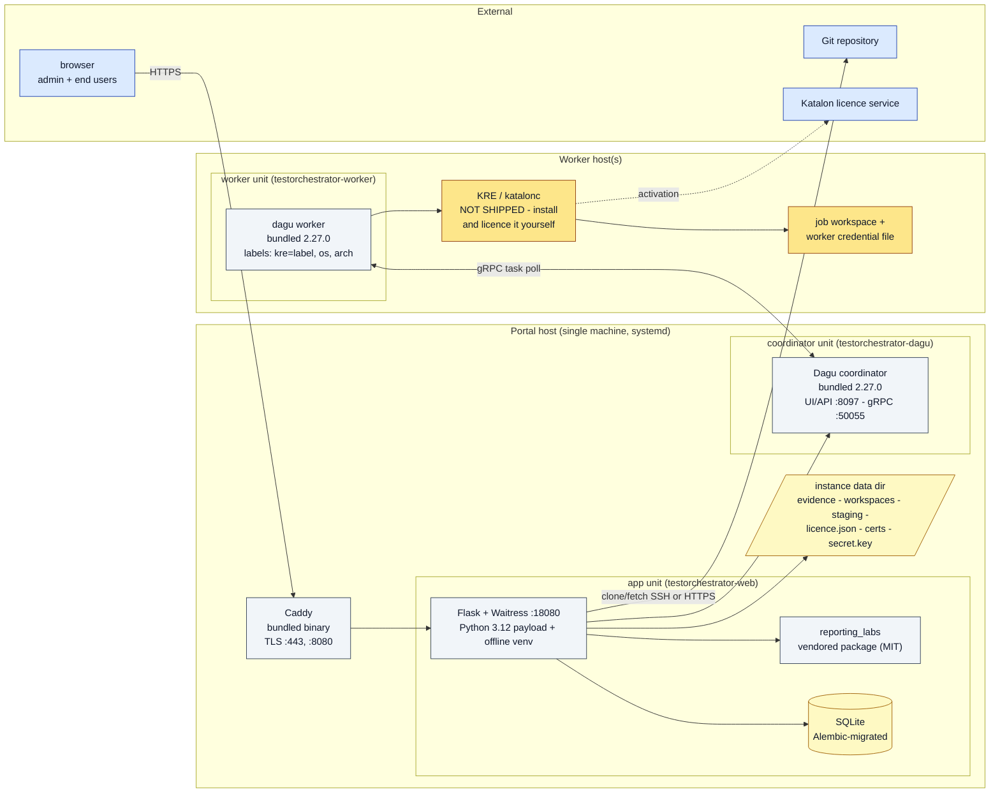

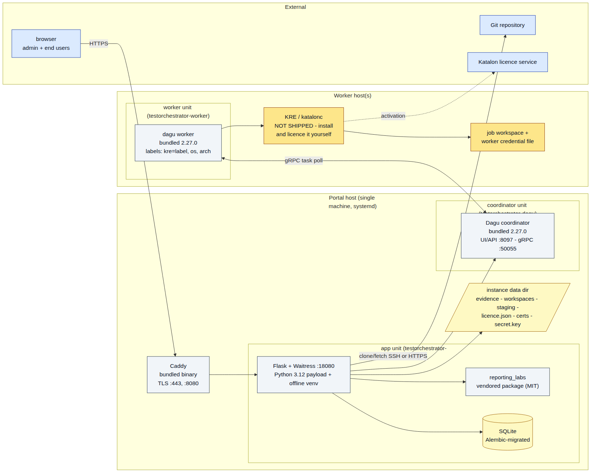
*(rendered from the diagram above for PDF/offline readers — source:
`Screenshot-Doc/admin/architecture-diagram.mmd`)*

Colour key: grey = shipped binaries (Caddy, Flask/Waitress app,
reporting_labs, Dagu coordinator/worker); yellow = persistent data;
amber = **not shipped** — KRE and worker-side files you install and
licence yourself; blue = external services.


| Piece | Ships as | Notes |
|---|---|---|
| Portal | Python 3.12 payload + offline venv | Flask/Waitress; SQLite (Alembic-migrated) in the instance dir |
| Dagu coordinator + worker | Bundled Dagu **2.27.0** binaries | Coordinator serves UI/API + gRPC; workers poll it for tasks |
| Caddy | Bundled binary | Optional-but-supported HTTPS terminator; the app renders/validates its config with rollback |
| reportingLabs | Vendored package `reporting_labs` (MIT) | Generates per-execution HTML reports |
| KRE | **Not shipped** | Install/license it on each execution host yourself |

### What an install places on the host

A supported install (tarball `install.sh` / `.run`, or the Windows
installer) creates three trees plus service definitions:

| Location | Contents |
|---|---|
| **Payload** (`--payload`, default under the install root) | Application source (`testorchestrator/`, `wsgi.py`), `3rdparty/` (bundled `python-runtime`, `python-wheels`, `git`, Dagu archives, `reporting_labs` — **since 2.0.3 at `3rdparty/reporting_labs`**, Caddy), the app `venv/` built offline from the bundled wheels, `requirements.txt`, licences |
| **Config** (`--config`) | `web.env` (service settings — not secrets), `Caddyfile`, `dagu/server.yaml` + `dagu/credentials` (0600), staged systemd units (`testorchestrator-web`, `-worker`, `-dagu`, `-caddy`) |
| **Data** (`--data`) | SQLite instance DB (Alembic-migrated on upgrade), `dagu/dags/` workflow definitions, `evidence/` per-execution artifacts, `certs/`, `logs/`, `workspaces/` per-run checkouts |

Services: `testorchestrator-web` (Waitress :18080 loopback),
`testorchestrator-caddy` (HTTPS terminator), `testorchestrator-dagu`
(coordinator: UI/API + gRPC), `testorchestrator-worker` (local agent
launcher). On a host without systemd, `--no-service-start` stages the
units only — start the processes manually with the same config files.

### Data flow

**Live execution** — numbered flows ①–⑲ trace a dispatch end to end:

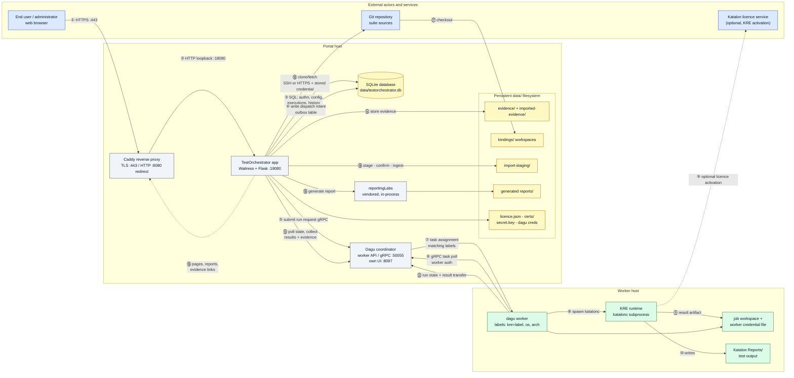

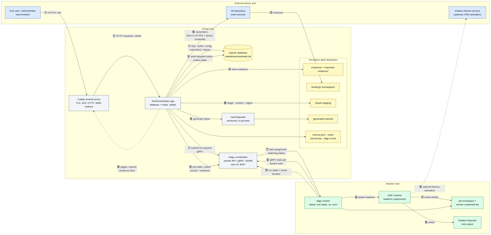
*(rendered from the diagram above for PDF/offline readers — source:
`Screenshot-Doc/admin/dataflow-diagram.mmd`)*

Flow summary: ①–③ the browser reaches the portal over HTTPS through
Caddy → Waitress; the app reads/writes SQLite. ④–⑧ a dispatch is
recorded in the outbox, submitted to the Dagu coordinator over gRPC,
and claimed by the worker whose labels (`kre=<label>`, os, arch) match
the runtime's `worker_label`; the worker spawns `katalonc`. ⑨ KRE may
contact Katalon's licence service (separate from the portal licence).
⑩–⑭ results and evidence travel back through the coordinator → the app
→ `evidence/` and execution rows. ⑮ reportingLabs renders a report in
process; ⑯–⑱ cover repository bindings (clone → workspace →
stage/confirm/ingest); ⑲ everything is served back to the browser
through Caddy.


**Historical-result import** follows the same storage path minus the
worker: preview classifies repo results → confirm writes executions,
results, and imported evidence → the same report/evidence views serve
them. Evidence that never reached the repository cannot be recreated
(see User Manual §6).

## 2. Platforms and prerequisites

### 2.1 Linux

- x86-64 Linux with glibc; the package is fully self-contained —
  **no system Python, pip, or network needed at install time**
  (bundled runtime + vendored wheels).
- Root (or sudo) only for system-wide installs under
  `/opt`/`/var/lib`/`/etc` + systemd units. A non-root user can run
  the entire payload with `--no-service-start` and explicit
  `--payload/--data/--config` directories.
- Outbound reachability to your Git hosting for bindings/imports.
- `git` is not required on the host — a pure-Python backend
  (dulwich) handles clone/fetch/checkout.

### 2.2 Windows

- Windows amd64, installed via `testorchestrator-2.0.3-windows-amd64-setup-UNSIGNED.exe`.
  The dagu-worker installer is bundled inside the app package —
  download it from the installed portal (§6.1); it is not a
  separate release download.
- **[code/CI]** Documented from installer code + CI jobs
  (`windows-installer` workflow: compile, installed-validate,
  upgrade-from-v102, upgrade-from-v200). **No local Windows install
  or interactive test was performed for this manual**, and both
  installers are **unsigned** — expect SmartScreen warnings and plan
  your own signing/trust policy before production rollout.

## 3. Package selection and verification

Download from the GitHub release `v2.0.3`:

| Asset | Use |
|---|---|
| `testorchestrator-2.0.3-linux-x86_64.tar.gz` | Linux payload + installer |
| `testorchestrator-2.0.3-linux-x86_64.run` | Self-extracting variant of the same payload |
| `testorchestrator-2.0.3-windows-amd64-setup-UNSIGNED.exe` | Windows app installer (**unsigned**) |
| `SHA256SUMS.txt` | Checksums, one entry per binary |
| `build-manifest-linux.json` / `build-manifest-windows.json` | Provenance: source commit, `dirty` flag, tool versions |

The dagu-worker installer (`testorchestrator-dagu-worker-`
`2.27.0-setup-UNSIGNED.exe`) is **bundled inside both packages**
— Linux tarball at `packaging/windows/…`, Windows installer at
`packaging\\windows\\…` in the installed tree — and is served
by the portal as a download (§6.1). It is no longer published as
a standalone release asset.

Verify before installing **[verified]**:

```bash
curl -LO https://github.com/IT-Space-2026/TestOrchestrator/releases/download/v2.0.3/SHA256SUMS.txt
curl -LO https://github.com/IT-Space-2026/TestOrchestrator/releases/download/v2.0.3/testorchestrator-2.0.3-linux-x86_64.tar.gz
sha256sum -c SHA256SUMS.txt --ignore-missing
# testorchestrator-2.0.3-linux-x86_64.tar.gz: OK
```

Expected digests (from the release record — see `SHA256SUMS.txt`
on the release page for the authoritative values):

```
2b4d9751…  testorchestrator-2.0.3-linux-x86_64.tar.gz
7fef2b18…  testorchestrator-2.0.3-linux-x86_64.run
ea7ec2fc…  testorchestrator-2.0.3-windows-amd64-setup-UNSIGNED.exe
```

The bundled dagu-worker installer is verified by the portal at
download time — **System → Workers & runtimes** shows its SHA-256
next to the link.

The manifests pin the exact source commit and the bundled Dagu
version (`2.27.0`).

## 4. Linux installation

### 4.1 Requirements

- No licence is required to install or run the application — the
  TestOrchestrator application licence is **informational only**
  (§12.4). If you were issued a code (`TO1.…`) and want it recorded,
  pass it via the `TO_LICENCE_CODE` environment variable (never
  logged); it is validated and stored for status display, but a
  rejected or absent code never aborts the install.

### 4.2 Tarball install **[verified]**

```bash
tar -xzf testorchestrator-2.0.3-linux-x86_64.tar.gz
cd testorchestrator-2.0.3-linux-x86_64

# interactive — licence prompt is optional (Enter skips it)
sudo bash install.sh

# or unattended, explicit directories, units staged but not started:
bash install.sh \
    --payload /opt/testorchestrator \
    --data /var/lib/testorchestrator \
    --config /etc/testorchestrator \
    --https-port 443 --http-port 8080 \
    --no-service-start --yes
```

What the installer does, in order **[verified — every step observed]**:

1. If a licence code was supplied (`TO_LICENCE_CODE` or the interactive
   prompt), validates it offline (Ed25519) against the bundled
   `release/licence_pubkey.pem` and writes `licence.json` into the
   data dir. A rejected, expired, or absent code logs a warning and
   the install continues — licensing is informational only.
2. Copies the payload (`testorchestrator/`, `wsgi.py`,
   `requirements.txt`, `release/`, `3rdparty/`, `migrations/`,
   `deploy/`, `scripts/`) plus the bundled dagu-worker installer
   into `packaging/windows/` — the portal serves it as a worker
   download (§6.1).
3. Creates the offline venv from the bundled Python + vendored wheels.
4. Provisions Dagu: binary + `server.yaml` (basic auth) +
   `credentials` file (`0600`) + execution workflow + a systemd unit
   under `config/dagu/`. Set `TO_DAGU_PROVISION_PASSWORD` beforehand
   so the coordinator credential matches what the portal stores; if
   unset, a random token is generated and the installer warns — store
   that token in the portal under **Admin → Credentials** afterwards.
5. Stages systemd units (`testorchestrator-web`, `-worker`, `-dagu`,
   `-caddy`) and a `Caddyfile` under the config dir. With root +
   systemd and no `--no-service-start`, they are enabled and started;
   otherwise they are left for manual activation.

> **Known limitation of the released 2.0.2 payload copy** — the copy list
> above omits `reporting_labs/` (the vendored report generator), so
> an `install.sh`-installed 2.0.2 system cannot generate reports until
> the workaround in §10 is applied. **Fixed in 2.0.3:** the
> package lives at `3rdparty/reporting_labs`, arrives via the
> `3rdparty` copy item, and the installer fails loudly if any required
> payload file is missing.

Other `install.sh` flags: `--dry-run` prints the plan;
`--service-user` overrides the unit user.

A real install transcript (dev-mode run — the `/tmp/…` paths are
the `--payload`/`--data`/`--config` directories chosen for this
documentation install; a production run uses `/opt`,
`/var/lib`, `/etc`):

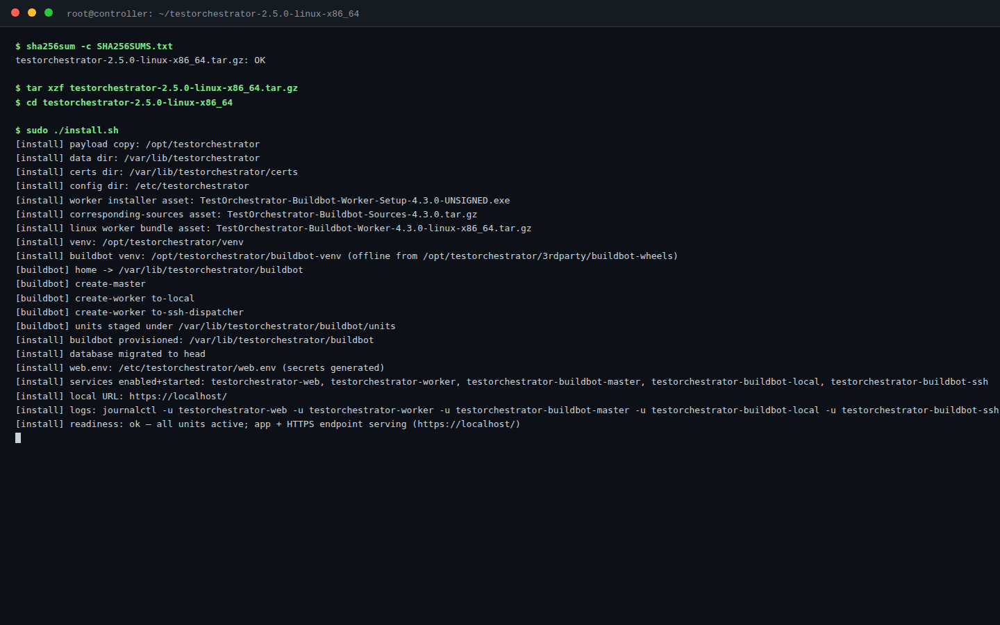

### 4.3 The `.run` self-extracting package

`testorchestrator-…-.run` wraps the same tarball; it extracts and
invokes the installer with the same options. Verify its checksum the
same way, then run it with `bash <file>.run` (or make it executable).
The payload it produces is byte-identical to the tarball's.

### 4.4 First startup and bootstrap **[verified]**

With staged units enabled the flow is automatic. For a manual/
non-systemd start (what a dev or doc install uses):

```bash
export TO_INSTANCE_DIR=/var/lib/testorchestrator
export TO_SECRET_KEY=$(python3 -c 'import secrets; print(secrets.token_hex(32))')
/opt/testorchestrator/venv/bin/python -m testorchestrator db-upgrade   # apply schema migrations
/opt/testorchestrator/venv/bin/flask set-admin-password '<strong-password≥12>'   # headless bootstrap
/opt/testorchestrator/venv/bin/waitress-serve --listen=127.0.0.1:18080 --threads=8 wsgi:app
```

- On a fresh install the first request lazily creates the bootstrap
  `Admin`/`Admin` account. Interactive bootstrap: sign in as
  `Admin`/`Admin` — the app forces a password change before anything
  else. Headless bootstrap: `flask set-admin-password` (≥12 chars)
  sets it and marks setup complete.
- `TO_SECRET_KEY` **must** be stable across processes or sessions
  invalidate on restart — put it in `web.env`.
- `toctl db-upgrade` applies pending Alembic migrations; it is
  idempotent and safe before every start/upgrade.

What a brand-new install looks like at first login:

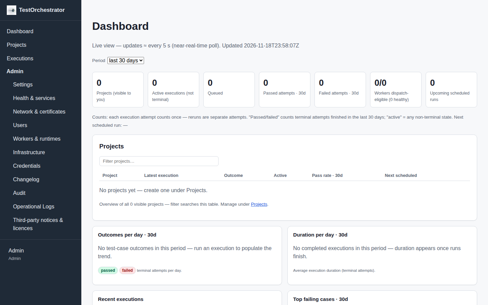

- **Users** lists exactly one account — the bootstrap `Admin`.
  Create real accounts next (§12.3):

  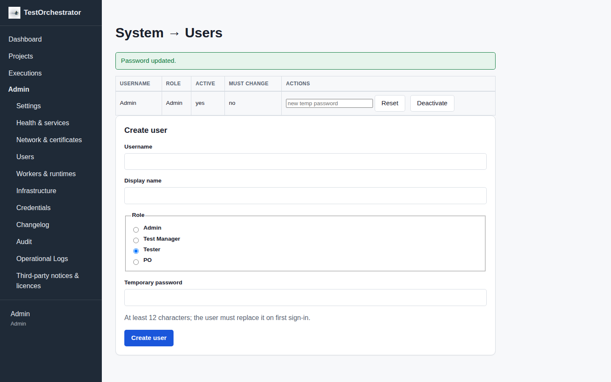

- **Infrastructure** shows no workers and no KRE installations yet —
  this is where §12.1 and §12.2 start. The **Download execution
  worker** card already serves the pinned Dagu build with its
  SHA-256:

  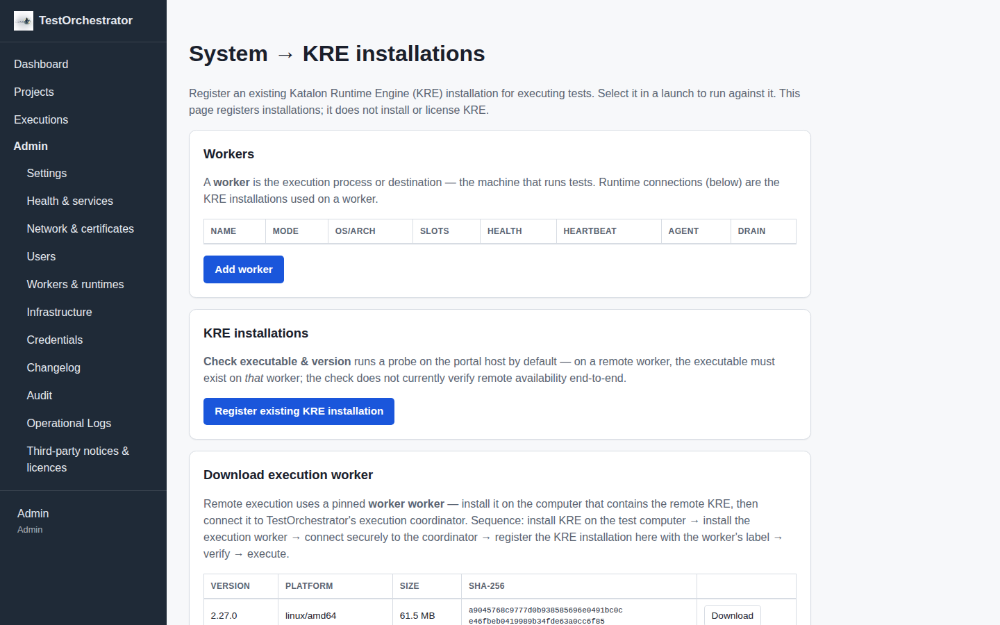

- **Health & services** shows every unit `not installed` until the
  staged systemd units are enabled — expected on a
  `--no-service-start` or non-root install, not a fault:

  

### 4.5 Directory layout **[verified]**

| Path (default / this doc install) | Contents |
|---|---|
| `--payload` `/opt/testorchestrator` | Code, bundled runtime/wheels, `release/` (version, pubkey), `venv/`. Replaceable wholesale on upgrade. |
| `--data` `/var/lib/testorchestrator` | Instance dir: `testorchestrator.db`, `certs/`, `licence.json`, `bindings/` (worktrees), `imported-evidence/`, `import-staging/`, `remote-runs/`, `agent-work/`, `dagu/` (DAGU_HOME). **This is the state — back it up.** |
| `--config` `/etc/testorchestrator` | `web.env`, `Caddyfile`, `dagu/` (server.yaml, credentials, unit), staged systemd units. |
| `data/dagu` vs `config/dagu` | Runtime state/DAGs vs provisioned binary+config+credentials. |

`TO_INSTANCE_DIR` points the app at the data dir; `TO_DATABASE_URI`,
`TO_CERT_DIR`, `TO_CADDY_BIN`, `TO_CADDY_CONFIG_DIR` override
individual locations.

### 4.6 Ports and network flows

| Flow | Default | Configure |
|---|---|---|
| Browser → Caddy | 443 / http 8080 | `--https-port`/`--http-port`; **Admin → Network & certificates** renders the real Caddyfile (staged apply + `previous_good` rollback) |
| Caddy → Waitress | `127.0.0.1:18080` | unit `ExecStart` / `waitress-serve --listen` |
| Portal → Dagu API | `http://<host>:8096` | setting `dagu_endpoint` |
| Worker → coordinator gRPC | `<host>:50055` | setting `dagu_coordinator_url`; worker flag `--worker.coordinators` |
| Worker health | `:8092` | `--worker.health-port` (`0` disables) |

Access gates (bootstrap.py): every request must arrive under a
configured host alias (403 otherwise); until setup is complete **and**
`external_enabled` is set, only loopback clients may connect; a
bootstrap session is confined to the password-change form until the
temporary credential is replaced. Set `advertised_base_url` to the
public URL before enabling external access.

### 4.7 Service management and logs

```bash
systemctl enable --now testorchestrator-web testorchestrator-worker \
    testorchestrator-dagu testorchestrator-caddy
journalctl -u testorchestrator-web -u testorchestrator-worker \
    -u testorchestrator-dagu -u testorchestrator-caddy -f
```

- `testorchestrator-worker` runs the dispatch loop
  (`flask worker`); without it, queued executions never dispatch.
- In-app observability: **Admin → Health & services** (per-service
  status), **Admin → Operational Logs** (application log, export,
  tail), **Admin → Audit** (recorded administrative/security events),
  **Admin → Changelog** (upgrade history).
- `toctl readiness` probes the health endpoint on the configured port.


### 4.8 Uninstall

Stops to take, in order:

1. `systemctl disable --now testorchestrator-web …` (all four units),
   remove the unit files; stop any manually started
   coordinator/worker processes.
2. Remove the **payload** directory — that removes the application
   only.
3. The **data** and **config** dirs contain all state (database,
   evidence, licences, secrets key, credentials). Delete them only if
   you mean to destroy the installation's history; keep them for a
   reinstall or archive them first.

Removing the payload never deletes data; deleting data is always an
explicit separate step.

## 5. Windows installation **[code/CI — not locally validated]**

From the installer (`app-installer.nsi`, `build_app_installer.sh`,
`packaging/windows/`):

- `testorchestrator-2.0.3-windows-amd64-setup-UNSIGNED.exe` lays down
  the embedded-Python payload, `toctl.exe`, and the same
  `toctl install`/`toctl web` entry points (`python -m
  testorchestrator` equivalent on source layouts). Follow the
  installer's prompts; the app data lives in the configured instance
  location.
- The bundled `testorchestrator-dagu-worker-2.27.0-setup-`
  `UNSIGNED.exe` (inside the app installer and the Linux tarball,
  served via **System → Workers & runtimes**) installs the Dagu
  worker binary; register labels and the coordinator address per
  §6.
- **Both installers are unsigned.** Windows will warn; verify the
  published SHA-256 before running, and sign them internally if your
  policy requires it.
- Windows CI proves compile + installed validation + upgrades
  (v1.0.2→, v2.0.0→); interactive Windows use was **not** validated
  for this manual.

### 5.1 Install and first access

1. Run the installer **elevated** (admin) — required for the
   `%ProgramFiles%` payload, `%ProgramData%` state, Scheduled Tasks,
   and machine trust.
2. Unattended: `setup.exe /S [/D=<path>] [/PORT=8080]
   [/ADDR=localhost]`.
3. The installer registers and **immediately starts** four
   SYSTEM/ONSTART Scheduled Tasks — `TestOrchestratorWeb` (Waitress,
   `127.0.0.1:18080`), `…Worker`, `…Dagu`, `…Caddy` (HTTPS `:443`).
   No reboot is required; tasks also restart at boot.
4. Browse to `https://localhost/` → sign in (bootstrap admin
   credentials are printed by the installer) → use. If no application
   licence is installed the login page shows the informational notice
   *"This version is not supported"* — it does not restrict anything.

### 5.2 Certificate trust (what the installer does for you)

- Mode `tls internal`: Caddy generates a **fresh, per-installation
  local CA** at first start under
  `%ProgramData%\TestOrchestrator\caddy-home\Caddy\pki`. The private
  key is created on the machine, never shipped in the package, never
  shared between installations.
- The installer waits for `…\authorities\local\root.crt` and runs
  `certutil -addstore -f Root` — the CA lands in the **LocalMachine**
  Trusted Root store, so Edge/Chrome and other system-store clients
  validate `https://localhost/` **with no certificate bypass**.
- **Firefox** uses its own trust store — the one unavoidable manual
  step: import the same `root.crt` (Settings → Certificates →
  Import), or use a system-store browser.
- Leaf renewal is automatic — Caddy renews short-lived leafs while
  running; the root CA (~10 y) outlives the install.
- Upgrade: `caddy-home` persists under `%ProgramData%` → same CA →
  trust carries over.
- Uninstall removes **this** installation's CA by thumbprint (other
  Caddy CAs untouched). Customer data under `%ProgramData%\TestOrchestrator`
  is kept unless explicitly confirmed.

### 5.3 Stop, restart, uninstall

- Supported stop: `%ProgramData%\TestOrchestrator\stop_to.cmd` — ends
  all four tasks **and** reaps orphaned child processes. Plain
  `schtasks /End` only kills the `.cmd` host and leaves python/caddy/
  dagu children bound to their ports — do not use it alone.
- Logs: `%ProgramData%\TestOrchestrator\logs\{web,worker,dagu,caddy}.log`
  (Task Scheduler provides no stdout capture; wrappers append here).
- Uninstall entry points are registered under
  `HKLM\SOFTWARE\Microsoft\Windows\CurrentVersion\Uninstall\TestOrchestrator`:
  - `UninstallString` → `uninstall.exe` (interactive NSIS flow:
    prompts before deleting `%ProgramData%`; `/PURGEDATA=1` forces
    removal).
  - `QuietUninstallString` → `cmd /c "...uninstall_to.cmd"` — silent,
    deterministic (the NSIS silent uninstaller is unreliable in
    Session-0/headless contexts); requires elevation. **Retains data
    by default.** Pass `/PURGE` (aliases `/PURGEDATA`,
    `/PURGEDATA=1`) for full removal.
- Both flows do the same cleanup — untrust this installation's CA
  only, stop services and reap children, delete the four tasks,
  remove the payload, remove the ARP registry entry — and the same
  retention default (keep data unless purge is explicitly chosen).

### 5.4 Remote access — separate deployment mode

Local `https://localhost` needs none of this. For LAN/remote clients:

- Install with `/ADDR=<hostname>` so generated config/redirects use
  it.
- The internal CA issues a leaf for the configured name only — remote
  clients need the same `root.crt` imported, or provide a real
  CA-issued certificate via the admin **Network & certificates** page
  (`tls` file mode) — the recommended production posture.
- Firewall: inbound 443 (and 8080 if the HTTP→HTTPS redirect is used)
  must be opened by the client administrator.

### 5.5 Validation gates — honest status

Verified on disposable CI (`windows-latest`): silent install, payload
completeness (including the worker-download assets — dagu archives +
bundled worker installer), task registration + start, HTTP readiness,
task restart, HTTPS with real certificate validation, licence
negative/positive/persistence, report generation. **Pending on an
interactive Windows host:** GUI installer screens, real-browser
activation flow, actual reboot persistence, upgrade-in-place, and
uninstall UX.

## 6. Workers — installation and operation (Linux) **[verified end to end]**

### 6.1 Get the worker archive through the portal

The portal serves the pinned worker build to authenticated users —
this is the supported way to obtain it (it guarantees the worker
version matches the coordinator pin):

```
GET /system/infrastructure/dagu-worker/dagu_2.27.0_linux_amd64.tar.gz
```

```bash
curl -L -b cookies.txt -o dagu_2.27.0_linux_amd64.tar.gz \
    https://<portal>/system/infrastructure/dagu-worker/dagu_2.27.0_linux_amd64.tar.gz
```

### 6.2 Verify the asset **[verified]**

The pinned digest is published in the build manifest / release notes:

```bash
sha256sum dagu_2.27.0_linux_amd64.tar.gz
# a9045768c9777d0b938585696e0491bc0ce46fbeb0419989b34fde63a0cc6f85 (2.0.2 pin)
tar -xzf dagu_2.27.0_linux_amd64.tar.gz -C /opt/dagu-worker
/opt/dagu-worker/dagu version     # → 2.27.0
```

### 6.3 Configure the coordinator

On the portal host **[verified]**:

- `scripts/provision_dagu.py` (run by `install.sh`) writes
  `config/dagu/` containing: `dagu` binary, `server.yaml`
  (`auth.mode: basic` + credential), `credentials` (`0600`,
  `username=`/`password=`), the execution DAG in
  `data/dagu/dags/testorchestrator-execution.yaml`, and a systemd
  unit.
- Start it (unit, or manually — note `DAGU_HOME`, a private `TMPDIR`
  so Dagu's `$TMPDIR/dagu` temp dir cannot collide with stray files,
  and `--coordinator.advertise` when the hostname does not resolve
  to a bound address):

```bash
DAGU_HOME=/var/lib/testorchestrator/dagu TMPDIR=/var/lib/testorchestrator/dagu-tmp \
  /etc/testorchestrator/dagu/dagu start-all \
  --host 127.0.0.1 --port 8096 \
  --coordinator.host=127.0.0.1 --coordinator.port=50055 \
  --coordinator.advertise=<reachable-addr> \
  --config /etc/testorchestrator/dagu/server.yaml \
  --dags /var/lib/testorchestrator/dagu/dags
```

- Portal settings (**Admin → Settings** or DB):
  `dagu_endpoint` (coordinator http URL), `dagu_coordinator_url`
  (host:grpc-port), `dagu_username`, `dagu_credential_ref` — a
  Credentials entry holding the coordinator basic-auth token, and the
  opt-in `dagu_mandatory` toggle when remote dispatch should be
  required rather than best-effort.

### 6.4 Register the worker

On the worker host **[verified]**:

```bash
TMPDIR=/var/lib/dagu-worker/tmp \
  /opt/dagu-worker/dagu worker \
  --worker.id=worker-01 \
  --worker.labels="kre=api" \
  --worker.coordinators=<portal-host>:50055 \
  --worker.health-port=8092
```

- `--worker.labels` are the capabilities the portal matches against
  (`kre=<label>`); `os`/`arch` labels are added automatically.
- Registration is verified from the coordinator API or the portal's
  **Admin → Infrastructure** view (`/api/v1/workers` lists id,
  labels, health, version):

```bash
curl -u <coord-user>:<coord-pass> http://127.0.0.1:8096/api/v1/workers
```


### 6.5 Register the KRE installation on the worker

**Admin → Infrastructure → KRE installations → Register**: give the
connection a name, select the runner/worker, set the **executable
path** *as it exists on the worker* (e.g.
`/opt/kre/katalonc`), the **workspace root** the worker may use, and
the `worker_label` that selects it. The portal's *Check* probes the
executable on the portal host by default — for remote runtimes the
page itself states that remote availability is **not** verified
end-to-end; a remote check shows `Remote — not verified`. Keep the
executable's licence/API key on the worker (KRE `-apiKey` / offline
licence) — the portal cannot license it for you.

### 6.6 Dispatch a controlled demonstration job **[verified]**

Queue a suite run choosing the remote runner + runtime; the portal
dispatches with `worker_selector = {kre: <label>}`, the worker
executes `prepare → checkout → run_kre → collect`, and results
(JUnit, logs, screenshots, `execution.uuid`) return portal-side into
`remote-runs/<execution-id>/`. The execution page shows the worker,
the dagu run, and the returned artifacts.

### 6.7 Logs, stop, restart, removal

- Coordinator log: the unit's journal, or the file you redirect
  `start-all` output to. Worker log: same, on the worker host; the
  worker-side run log is also returned as an execution artifact.
- Stop a worker by terminating its process; drain it first via
  **Drain worker** (Infrastructure) so it stops accepting new tasks.
- Restart is a fresh `dagu worker` with the same `--worker.id` —
  labels and id must be stable for selection to keep working.
- Removing a worker: drain, stop the process, remove its install
  dir. In-flight executions on it will fail as infrastructure
  failures; finished ones are unaffected.

### 6.8 Windows worker **[code/CI]**

Install `testorchestrator-dagu-worker-2.27.0-setup-UNSIGNED.exe`
(**unsigned**), then run the same `dagu worker` invocation (Windows
flags identical: `--worker.id`, `--worker.labels`,
`--worker.coordinators`) pointed at the coordinator. Not
interactively validated here.

## 7. Security and administration

### 7.1 Users and roles **[verified]**

**Admin → Users**: create users with role Admin / Test Manager /
Tester / PO and a temporary password (≥12 chars, must be replaced at
first sign-in); reset or deactivate accounts. Passwords are
argon2-hashed; a session-version counter invalidates sessions on
credential change.

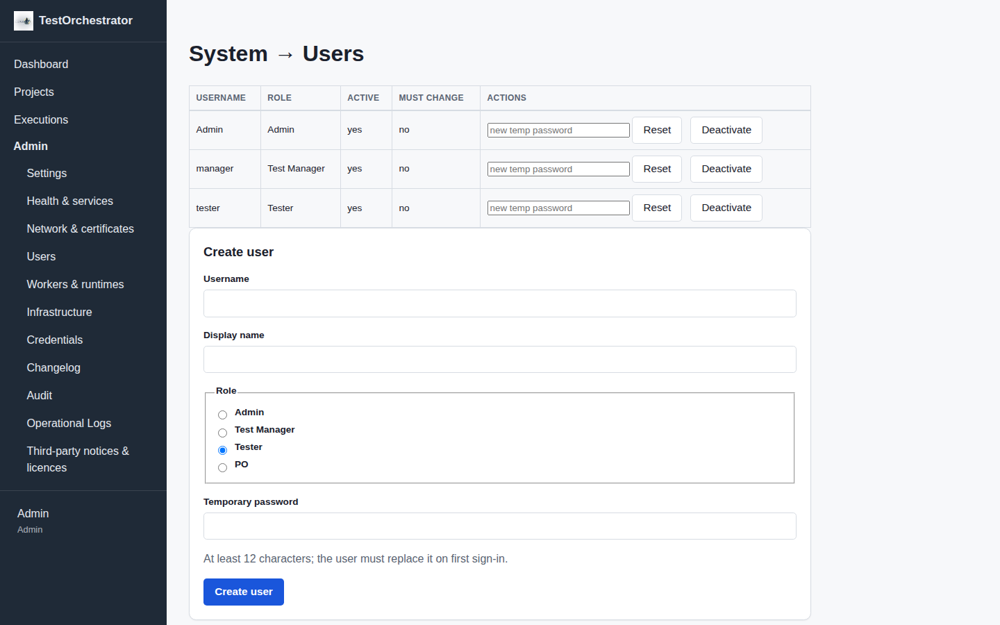

### 7.2 Secrets **[verified]**

**Admin → Credentials** stores `git` (HTTPS token / SSH key) and
`runtime` (KRE licence / invocation secret) values. Values are
encrypted at rest with a key held *outside* the database
(`secret.key` in the instance dir — protect and back it up), are
never re-displayed, never logged, and never exported; bindings and
runtimes reference them by name only. Dagu coordinator and
worker-enrollment credentials are **system-managed** — provisioned by
the platform (`coordinator-agent`) and protected from deletion.


### 7.3 Worker authentication

Portal↔coordinator API calls authenticate with the provisioned basic
credential (§6.3). Worker processes authenticate their coordinator
connection with the system-managed `coordinator-agent` credential;
**Issue token** on the Infrastructure page issues worker enrollment
tokens for `agent`-mode connections.

### 7.4 File permissions and TLS

- The installer writes `credentials`, `server.yaml`, `licence.json`,
  `secret.key`, and certs with owner-only modes (0600/0700 dirs) —
  keep them that way; the units run as a dedicated `testorchestrator`
  user with `ProtectSystem=strict` and explicit `ReadWritePaths`.
- TLS terminates at Caddy using certs under `data/certs` (or
  `TO_CERT_DIR`); **Admin → Network & certificates** can generate or
  import a certificate and render the Caddyfile with staged apply +
  rollback. The Waitress app binds loopback only — it is never meant
  to face the network directly.

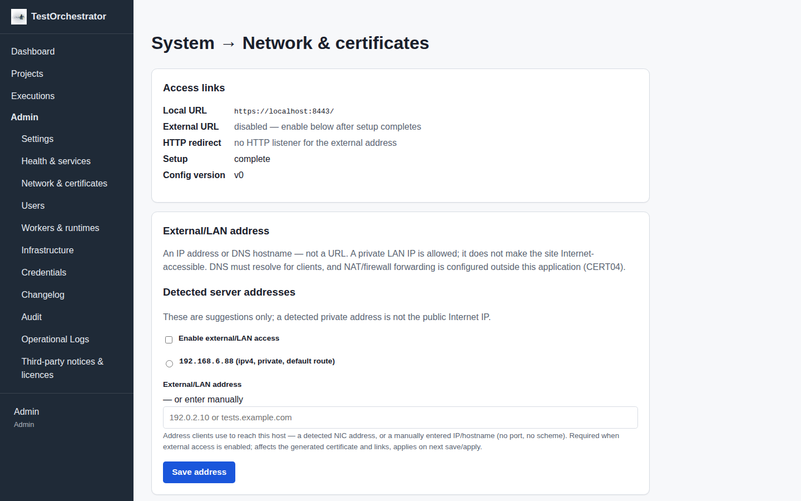

### 7.5 Logging and sensitive data

Application logs (Admin → Operational Logs) avoid secrets by
construction — credential values are never written to logs or
exports. Audit events record administrative actions (logins,
config changes, deletions) without payloads.

## 8. Backup, restore, and upgrades

### 8.1 What to back up

| Path | Why |
|---|---|
| `data/testorchestrator.db` | Executions, results, users, settings, import bookkeeping |
| `data/` (rest) | Evidence (`imported-evidence/`, `remote-runs/`), `licence.json`, `certs/`, `secret.key`, bindings worktrees |
| `config/` | `web.env`, `dagu/` credentials + server.yaml, Caddyfile |

`toctl backup --to <dir>` produces `backup-<timestamp>.tar.gz` of the
instance dir + cert dir (atomic: `.part` renamed on success; newest
N retained) **[verified]**. For a hot backup of the SQLite file use a
consistent method — `toctl backup` while the app is stopped, or
SQLite's own `VACUUM INTO`/`.backup` for a quiesced copy.

`toctl recover --from <archive> --into <dir>` restores into a
separate location **[verified — restore tested, see
Validation-Record]**: the archive is unpacked beside the original so
you can diff/migrate before swapping it in. Restored users/settings
come back as they were — recovery never reactivates a bootstrap
credential. The complete end-to-end restore procedure — including
what a DB-only backup cannot recover — is §16.

### 8.2 Upgrades

Verified path: released **2.0.1 → 2.0.2** on Linux
(2.0.1 package checksum-verified, seeded history + config + evidence,
then the 2.0.2 package pointed at the same instance dir +
`db-upgrade`) **[verified]**.

Procedure:

1. `toctl backup` first.
2. Stop services.
3. Install the new package (new payload dir, or the same `--payload`
   — the installer merges; stale files from removed components are
   cleaned by name only).
4. `toctl db-upgrade` — 2.0.2 applies exactly one additive migration
   (`r8s9t0u1v2w3`: `executions.suite_keys_json`, `import_locks`).
5. Start services; verify `toctl readiness` and spot-check history.
   Legacy rows are lazily fingerprinted on first use — no data
   rewrite happens at migration time.

**Recovery precautions.** There is no automatic DB downgrade —
restoring a backup taken *before* the upgrade is the rollback path,
and replacing binaries does not roll the schema back. Upgrades never
delete executions, evidence, settings, or credentials; if a
post-upgrade check shows missing history, stop and restore rather
than re-migrating.

## 9. Evidence and storage maintenance

### 9.1 Ownership

Evidence lives under managed roots inside the instance dir:
`remote-runs/<exec-id>/`, `imported-evidence/<exec-id>/`, and each
execution's recorded `report_dir`. A directory is **owned** by the
execution that created it; several executions may reference the same
imported tree.

### 9.2 What deletion removes

Deleting an execution queues: removal of its published remote report
copy → the DB row → its *owned* local directories, in that order —
the filesystem cleanup runs only after the DB delete commits.
Shared/referenced directories are skipped deliberately.
`remove_owned` is traversal- and symlink-confined: nothing outside
the managed roots is touched.

### 9.3 Evidence export (optional)

**Admin → Infrastructure & components → Git — evidence export
repository** configures an optional Git destination for
explicitly-requested evidence pushes. Export is never automatic —
local artifact storage is authoritative and works fully without it.
Only whitelisted kinds (`junit`, `log`, `screenshot`, `html`) plus
execution snapshots are exportable, under
`TestOrchestrator/projects/<id>/executions/<id>/`; users, secrets,
sessions, keys, and audit data are never written to the export.
Pushes are fast-forward/merge only — a conflicting remote surfaces an
honest error rather than being force-pushed. HTTPS remotes use a
named Secret (`user:pass` content); SSH relies on the host
ssh/agent — credentials are never embedded in URLs or logs.
`restore_definitions` can read exported project definitions back.

### 9.4 Import staging

Preview checkouts live under `import-staging/<session>/`. They are
kept while retryable candidates remain (so failed imports can be
re-confirmed) and cleaned when the batch finishes; stale staging from
interrupted sessions is reaped on the next preview.

### 9.5 `toctl evidence-prune` **[verified]**

```bash
TO_INSTANCE_DIR=/var/lib/testorchestrator \
  /opt/testorchestrator/venv/bin/python -m testorchestrator evidence-prune          # dry run (default)
  /opt/testorchestrator/venv/bin/python -m testorchestrator evidence-prune --apply  # delete
```

Output is JSON: `{"dry_run": …, "orphans": [...], "removed": [...]}`.
Dry run lists managed directories no live execution references and
deletes nothing. `--apply` removes only those listed orphans —
directories referenced by any execution are never listed. Storage
inspection is otherwise plain `du`/`find` under the managed roots.

## 10. Troubleshooting

Quick-reference symptoms; the fuller incident matrix with
diagnostic commands is §21.

| Symptom | Check |
|---|---|
| `403` immediately after install | Host allowlist — browse the configured alias, not a bare IP; or loopback-only gate still on (setup incomplete / `external_enabled` unset). |
| `licence … warn` at install | Code expired/not-yet-valid (UTC dates), wrong product, or corrupted paste — the code is `TO1.<payload>.<signature>`. Warning only; the install still completes and the app is fully usable. |
| `cannot resolve '<ref>'` on sync/import | Bad ref/branch on the binding, or a shallow worktree missing the object — re-sync. |
| Coordinator `/api/v1/workers` → `503` | Coordinator's `--coordinator.advertise` address isn't bound/reachable — advertise an interface address, not a hostname that resolves elsewhere. |
| Remote run fails `mkdir /tmp/dagu: not a directory` | A stray file shadows Dagu's default temp dir — set a private `TMPDIR` for coordinator/worker processes. |
| Execution `failed` with `Activation failed` in the run log | KRE licence/API key missing on the worker — environment problem, fix on the worker. |
| `rl_status=failed`, log shows `No module named 'reporting_labs'` | **Known defect in released 2.0.1/2.0.2:** the `install.sh` payload copy omits the vendored `reporting_labs/` directory (present in the tarball root and in the Windows payload). **Workaround for 2.0.2 installations:** copy `reporting_labs/` from the extracted tarball into the payload dir (or run generation once with `PYTHONPATH=<tarball-root>`), then **Regenerate**; original artifacts are untouched. **Fixed in 2.0.3:** the installer copies the vendored package — now located at `3rdparty/reporting_labs` in both the package and the installed payload — and the app resolves it automatically; upgrading also removes a superseded root-level `reporting_labs` copy, so no manual copy or PYTHONPATH is needed. See Validation-Record §4. |
| Import says `staging checkout expired` | Staging was cleaned — rerun the preview; pending candidates were not committed. |

## 11. Demonstrated worker flow used for these docs

Every §6 step above ran on the isolated doc install:
portal-served worker download (SHA-256 pin match) → extraction →
`dagu worker --worker.labels="kre=doc-demo"` registration →
portal dispatch with selector `map[kre:doc-demo]` → completed
execution with returned JUnit/log/screenshot evidence and a
reportingLabs report. The dispatched job used a **fixture** KRE
stand-in — pipeline coverage, not licensed execution.

## 12. Runbooks — step by step

Condensed checklists for the most common provisioning tasks.
§6 has the verified long-form worker walkthrough; §7 has the security
detail. These are the same steps, in order, with every required field.

### 12.1 Add a worker

1. **Register the runner record** — **System → Infrastructure →
   Workers** → new entry: *Name*, *Description*, *OS/architecture*,
   *Connection mode* (`local` = same host as the portal; `remote` =
   reached via the Dagu coordinator), *Workspace root*, *Max
   concurrent slots*, *Allowed projects* (empty = all). Per-worker
   slots are a configured allowance — keep their sum within the
   purchased floating seats (noted on the form itself).

   

2. **Issue its agent token** — on the new runner's row, **Issue
   token**. The plaintext is shown **once** in the flash message —
   copy it now; only its SHA-256 is stored. Re-issuing revokes the
   old token.
3. **Get the worker software through the portal** (guarantees the
   coordinator version pin):
   - Linux: download
     `/system/infrastructure/dagu-worker/dagu_<ver>_linux_amd64.tar.gz`
     and verify it against the manifest SHA-256.
   - Windows: download the unsigned worker installer via
     `/system/infrastructure/dagu-worker-installer/…`.
   - Optional: download a generated launcher from **Infrastructure →
     worker → launcher** (`to-worker.sh` / `to-worker.bat`) — the
     coordinator address and `kre=<label>` are baked in, so raw
     backend flags are never assembled by hand.
4. **Install on the worker host** — extract to a dedicated directory,
   create the workspace root, and write the coordinator connection:
   gRPC address of the portal host plus the credentials file
   (0600) provisioned during install (§6.3).
5. **Start the worker with its KRE label** —
   `dagu worker --worker.labels="kre=<label>"` (plus auto `os`/`arch`
   labels). The `<label>` value is what the KRE registration binds to
   in the next step — pick it deliberately and keep it unique.
6. **Verify registration** — **System → Infrastructure** shows the
   worker as **live** once its heartbeat is fresher than ~2 minutes.
   A stopped or partitioned worker shows its last-seen time instead.
7. **To retire it**: **Drain** stops it from claiming new work while
   in-flight runs finish; then stop the process and remove the runner
   record.

### 12.2 Register a KRE installation (runtime connection)

Prerequisite: KRE installed **and licensed** on the execution host —
the portal cannot supply the Katalon licence.

1. **System → Infrastructure → KRE installations → New** —
   set *Execution location*:
   - **`remote`** (worker host, the normal case): *Dagu worker label*
     is **required** and must equal the `kre=<label>` the target
     worker was started with — and be unique across installations
     (the submit rejects a duplicate or ambiguous label). If no
     explicit *Worker* is selected the portal auto-creates a
     `dagu-worker:<label>` runner for it.
   - **`local`**: KRE on the portal host itself.
2. Fill the fields:
   - *KRE path on the selected worker* — absolute path to `katalonc`
     **on that host** (required).
   - *Workspace root* — where the worker materialises run checkouts.
   - *Worker-side SSH key path* — only for `ssh://` bindings; a path
     on the worker's filesystem, key material never enters the portal.
   - *Credential reference* — a portal secret used at invocation.
   - *Worker-local credential file* — absolute path on the worker to
     a protected file (0700 dir / 0600 file); the workflow spec
     carries the path only, the worker resolves the value at exec
     time — this is the recommended way to keep KRE licence values
     off the portal entirely.
   - *Concurrency* — max simultaneous runs this installation takes.

   

3. **Probe** — on a *local* installation, **Probe** executes a
   version check and records the detected version + diagnostic.
   Probe is **not implemented for remote installations** — the flash
   says so explicitly; verify remote KRE by running a smoke suite.
4. **Enable/disable** with the toggle; **Edit** updates paths,
   labels, and concurrency without recreating the record.

### 12.3 Add a user and assign a role

1. **System → Users → New user**: *Username* (unique, ≤64 chars),
   *Display name*, *Role* (radio), *Temporary password* (≥12 chars).

   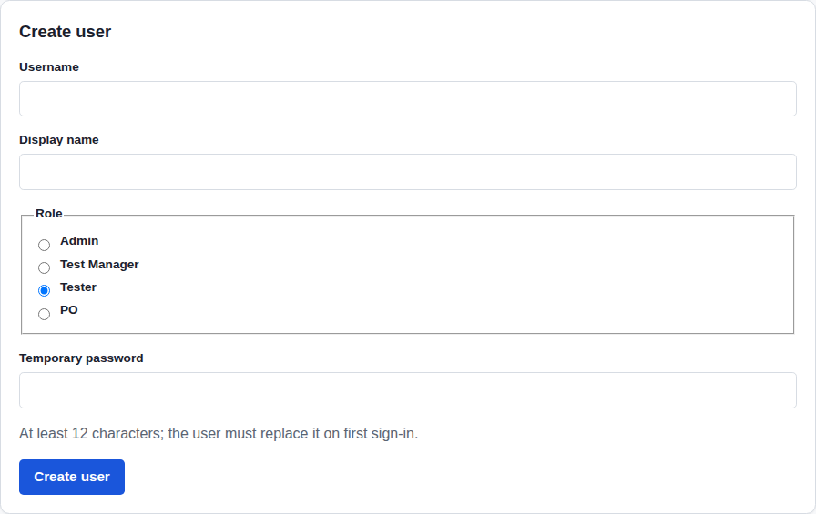
2. Hand the temporary password to the user — **first login forces a
   password change** (`must_change_password` is set on every created
   account; there is no way to create a user without it).
3. **Password reset** (same page): sets a new temporary password,
   flags the mandatory change again, **and revokes all existing
   sessions** for that user.
4. **Deactivate**: disables the account and revokes its sessions.
   The portal refuses to deactivate the last active Admin — promote
   another admin first.

Role capability summary (enforced server-side on every route):

| Role | Projects/bindings/suites/releases/schedules | Run & cancel | Users, infra, secrets, network, licence |
|---|---|---|---|
| **Admin** | create / edit / delete | yes | yes — full access |
| **Test Manager** | create / edit | yes | no |
| **Tester** | view | yes | no |
| **PO** | view | no | no |

### 12.4 Licence status (informational)

The application licence is verified **offline** — an Ed25519
signature checked against the public key bundled in the payload
(`release/licence_pubkey.pem`). No phone-home, no licence server.

**The licence does not gate anything.** Since 2.0.4 the application
licence is informational only: installation, startup, login,
projects, dispatch, workers, imports, reports, admin operations, and
the CLI all work with a missing, expired, or invalid licence. The
only user-visible effect of a non-valid licence is the notice
*"This version is not supported"* shown on the login page — login
itself is never blocked, and no other feature is restricted.
Authentication, roles, and project isolation are unaffected.

**At install time:** pass a code via `TO_LICENCE_CODE` (never
logged) or enter it at the optional interactive prompt to have it
recorded; skip it and the install proceeds identically (§4.2).

**In the running portal (view status / record a code):**

1. Sign in as **Admin** → **System → Licence** — the page shows the
   current state, every activated licence (ID, customer, validity),
   and the *Add licence* code field.

   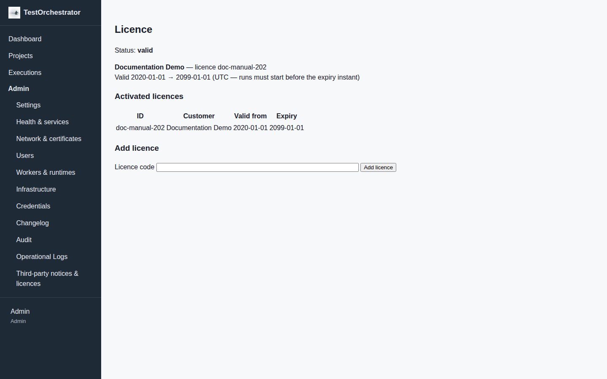

2. Paste the licence code (the `TO1.…` string you were issued) into
   the code field and submit.
3. The portal verifies the signature and stores the licence —
   success shows *"Licence activated for `<customer>` — valid
   `<from>` to `<to>`"*; failures show the reason (bad signature /
   malformed code).

**States shown on the page:** `missing`, `invalid`, `not-yet-valid`
(renewal stored, starts later), `valid`, `expired`. When the state is
anything other than `valid`, the login page shows *"This version is
not supported"* until a valid licence is recorded. This is distinct
from the KRE licence (§4.5 of the User Manual): KRE still requires a
valid Katalon licence/API key on the worker, and real KRE activation
failures continue to fail the affected runs.

---

## 13. Production deployment checklist

Order of operations for a new production install. Each line links to
the detailed procedure; none of the values below come from the
documentation environment (custom ports and fixture data there are for
screenshots only).

1. **Choose directories** — `--payload` (code, replaceable), `--data`
   (all state — the backup target), `--config` (units, `web.env`,
   Dagu credentials). Defaults `/opt`, `/var/lib`, `/etc`. §4.5.
2. **Licence code ready** — `TO1.…`, passed via `TO_LICENCE_CODE`.
   §4.1, §12.4.
3. **Install** — checksum the package (§3), run `install.sh` or the
   `.run`. §4.2, §4.3.
4. **Enable services** — copy the staged units, `systemctl
   enable --now` web/worker/dagu/caddy; confirm **Health & services**
   shows them installed and running. §4.4, §4.7.
5. **Bootstrap the admin** — `flask set-admin-password` or forced
   first-login change; then create named users. §4.4, §12.3.
6. **Public URL + TLS** — DNS → host, **Network & certificates** →
   set alias + ports, import or generate the certificate, **Apply**,
   verify rollback works. §4.6, §20.4.
7. **Repository access** — project binding + deploy credentials
   (SSH key or token) under **Credentials**. §6, §20.1.
8. **Workers + KRE** — install KRE on execution hosts, license it
   there, register runner + runtime in the portal, verify a live
   heartbeat. §12.1, §12.2.
9. **Backups** — schedule `toctl backup`, test `toctl recover --into`
   once before you need it. §8, §16.
10. **Acceptance run** — queue one suite on the real worker, confirm
    results + evidence + generated report return to the portal.
    §6.6, User Manual §4.

## 14. Configuration reference

Every supported knob — no hypothetical settings. Three layers:
environment variables (process env / `web.env`), persisted settings
(DB `settings` table — the Admin UI writes these), and installer
flags (one-time, at `install.sh`).

### 14.1 Environment variables (set in `web.env` / service unit)

| Variable | Purpose | Default | Secret | Restart |
|---|---|---|---|---|
| `TO_INSTANCE_DIR` | Instance data dir — the state root | `<payload>/instance` | no | yes |
| `TO_SECRET_KEY` | Flask session/CSRF signing key — **must be stable across restarts** or sessions invalidate | ephemeral per process | **yes** | yes |
| `TO_SECRET_KEY_FILE` | Path of the key file protecting stored secrets (`secret.key` in the data dir) | `$TO_INSTANCE_DIR/secret.key` | no (file is 0600) | yes |
| `TO_DATABASE_URI` | SQLAlchemy URI | `sqlite:///<instance>/testorchestrator.db` | may contain creds | yes |
| `TO_ADMIN_PASSWORD` | Bootstrap password used **once** at first provisioning (≥12 chars) — replaces `Admin`/`Admin` | unset → `Admin`/`Admin` + forced change | yes | first start only |
| `TO_SECURE_COOKIES` | `Secure` cookie flag (`1`/`0`) — `0` only for plain-HTTP dev | `1` | no | yes |
| `TO_SESSION_LIFETIME_HOURS` | Session lifetime | `8` | no | yes |
| `TO_WAITRESS_LISTEN` | Waitress bind (`host:port`) | `127.0.0.1:18080` | no | yes |
| `TO_TRUSTED_PROXIES` | Comma-separated peers whose forwarding headers are honoured | `127.0.0.1,::1` | no | yes |
| `TO_CERT_DIR` | Protected key/cert store (0700/0600) | `$TO_INSTANCE_DIR/certs` | no | yes |
| `TO_CADDY_BIN` | Caddy binary path | `payload/3rdparty/caddy/caddy` | no | yes |
| `TO_CADDY_CONFIG_DIR` | Rendered Caddyfile staging | `$TO_INSTANCE_DIR/caddy` | no | yes |
| `TO_INSTALL_ID` | Install identity — written by the installer; `toctl` refuses to service a foreign install | generated | no | yes |
| `TO_UPDATE_KEY` | Trusted public key path for signed update packages (`toctl update`) | unset | no | per-invocation |
| `TO_SERVICE_UNITS` / `TO_SERVICE_SCOPE` | Unit names + `--user`/system scope used by **Health → Restart services** | `testorchestrator-*` / `system` | no | yes |
| `TO_LICENCE_CODE` | Licence code for the installer (never logged) | required at install | yes | n/a |
| `TO_DAGU_PROVISION_PASSWORD` | Coordinator credential planted at provision so the portal matches | unset → random token + warning | yes | install-time |
| `TO_GIT_BACKEND` | `dulwich` \| `cli` git engine | `dulwich` | no | yes |
| `TO_SPEC_PREVIEW` | Dumps the rendered Dagu spec env for debugging | unset | may expose refs | per-invocation |
| `TO_SEED_<ROLE>_PASSWORD` | Test/demo account seeding | unset | yes | first start |

### 14.2 Persisted settings (DB — edited in the Admin UI)

| Key | Purpose | Default | Where |
|---|---|---|---|
| `setup_completed` | Bootstrap gate — loopback-only until true | `false` | set by first-password flow |
| `local_host` / `external_host` / `external_enabled` | Access aliases; external traffic is refused until enabled | `localhost` / `""` / `false` | **Network & certificates** |
| `bind_addresses` / `allowed_hosts` | Listeners + host allowlist (403 outside it) | loopback + `localhost` | **Network & certificates** |
| `advertised_base_url` | Public URL used in generated links/launchers | `https://localhost` | **Network & certificates** |
| `https_port` / `http_port` / `http_mode` | Public ports; `http_mode` = `redirect` \| `disabled` \| `development-insecure` | `443` / `8080` / `redirect` | **Network & certificates** |
| `internal_app_host` / `internal_app_port` | Waitress side of the proxy | `127.0.0.1` / `18080` | **Network & certificates** |
| `certificate_mode` / `certificate_reference` / `certificate_public_metadata` | TLS material selection (`""`/`local`/`imported`) — paths + public fields only, never key bytes | unset | **Network & certificates** |
| `previous_good_config` / `network_config_version` | Last-good network snapshot + apply counter — powers rollback | `{}` / `0` | automatic |
| `dagu_endpoint` | Portal → Dagu HTTP API URL | `""` | **Integrations** |
| `dagu_credential_ref` / `dagu_username` | Credential reference (secret name) + auth mode — value lives in **Credentials**, not here | `""` | **Integrations** |
| `dagu_coordinator_url` | Worker-facing gRPC coordinator address | `""` | backend-managed |
| `reportinglabs_enabled` | Enhanced reportingLabs generation on executions | `false` | **Reporting** |
| `logs_retention_days` / `logs_max_rows` | Operational-log pruning bounds | `30` / `20000` | **Reporting** / logs |
| `git_export_repo` / `git_export_credential_ref` / `git_export_ref` | Optional evidence-export target repo + credential ref + branch | `""` / `""` / `main` | **Reporting** |

Unknown keys are rejected (`KeyError`), upgrades never reset these,
and `update()` only accepts keys listed here.

### 14.3 Installer flags (one-time — `install.sh`)

`--payload` / `--data` / `--config` (directories), `--https-port` /
`--http-port` (Caddy listeners), `--service-user` (unit user),
`--no-service-start` (provision only), `--yes` (noninteractive —
still requires `TO_LICENCE_CODE`), `--dry-run` (print the plan),
`--upgrade` semantics: re-running on an occupied port refuses a
fresh install. §4.2.

## 15. Network and authentication matrix

| Flow | Initiator → destination | Port (default) | Protocol | AuthN | Expose beyond localhost? | Verify |
|---|---|---|---|---|---|---|
| Browser → portal | Browser → **Caddy** | 443 (+8080 redirect) | HTTPS | session cookie (CSRF per form) | **yes** — the public edge | `curl -Ik https://<host>` |
| Proxy → app | Caddy → **Waitress** | 127.0.0.1:18080 | HTTP | none — loopback + host allowlist | never | `curl -s 127.0.0.1:18080/login` |
| Portal → coordinator | Flask → **Dagu API** | 8096/`dagu_endpoint` | HTTP | basic-auth user, password via `dagu_credential_ref` **or** Bearer token | coordinator host only | `curl -u <u>:<p> <ep>/api/v1/dags` → 200/401 |
| Worker → coordinator | `dagu worker` → coordinator | 50055/`dagu_coordinator_url` | **gRPC** | coordinator credentials file (0600) provisioned at install | worker-reachable hosts | worker log: `connected`/poll OK; portal shows heartbeat |
| Portal → repositories | app → git remote | 22 or 443 | SSH/HTTPS | deploy key or token from **Credentials** | no (outbound) | binding **Sync**; check fetched SHA |
| Worker → KRE | worker → KRE binary | n/a (local exec) | process exec | KRE licence on the worker host | never | probe (local installs) or a smoke suite |
| App → evidence export | app → `git_export_repo` | 22/443 | git | `git_export_credential_ref` | no (outbound) | Reporting settings test/export |
| Agent → portal | worker agent → portal API | portal port | HTTP | one-time agent token (SHA-256 stored, shown once) | portal-reachable | runner row shows agent heartbeat |

Rules of thumb: only the Caddy ports and the coordinator gRPC port
must be reachable by *other machines*; everything else is loopback
or outbound. Worker→portal and portal→coordinator are *initiated
outbound* in both directions — no inbound listener is needed on a
worker host except its optional health port (disable with
`--worker.health-port=0`).

## 16. Disaster recovery — full restore

What a complete backup contains (§8.1), expanded into an end-to-end
procedure. **[doc-env — executed: real backup → restored instance
verified below]**

### 16.1 What to capture

- `data/` **entirely** — `testorchestrator.db` (+ `-wal`/`-shm`),
  `licence.json`, `secret.key`, `certs/` (0700/0600 — preserve modes),
  `imported-evidence/`, `remote-runs/`, `bindings/`, `dagu/` state.
- `config/` — `web.env`, `dagu/credentials`, `dagu/server.yaml`,
  Caddyfile.
- **Not needed**: `payload/` — rebuild by reinstalling the same
  package version.

**DB-only backup is not enough**: without `secret.key` every stored
credential (repository tokens, KRE refs) is unreadable; without
`licence.json` the licence record is gone; without `certs/` the
private keys are gone; without `imported-evidence/`/`remote-runs/`
the evidence files referenced by history are missing (rows survive,
files 404).

### 16.2 Consistency

Stop `testorchestrator-web` (or use SQLite's online backup
— `conn.backup()`, which is what `toctl backup` does internally
with `VACUUM INTO`-class consistency) before copying the `.db`.
WAL files must be checkpointed or copied together.

### 16.3 Restore procedure (tested)

```bash
# on the SOURCE — live-safe DB backup
python3 -c "import sqlite3; s=sqlite3.connect('data/testorchestrator.db'); \
            d=sqlite3.connect('backup.db'); s.backup(d)"
tar -czf to-backup.tar.gz --exclude='testorchestrator.db*' data/ config/

# on the TARGET — same-version package installed (§4.2), services stopped
toctl recover --from to-backup.tar.gz --into /var/lib/testorchestrator
# or manually: unpack, restore modes (certs/ 0700, *.key/credentials 0600)

TO_INSTANCE_DIR=/var/lib/testorchestrator venv/bin/python -m testorchestrator db-upgrade
```

**What must change when the host/URL differs**: `web.env`
(`TO_INSTANCE_DIR`, `TO_SECRET_KEY`), `dagu/server.yaml` + the
`dagu_endpoint`/`dagu_coordinator_url` settings if the coordinator
moved, `advertised_base_url` + `external_host` for a new DNS name,
and the Caddyfile. If `TO_SECRET_KEY` differs, every user session
is invalidated — nothing else breaks.

**Worker reconnection**: workers re-register on their coordinator
address automatically — update `--worker.coordinators` to the new
host and restart them; runner records, tokens, and labels come back
with the DB. A worker that stayed up through the outage resumes
claiming once the coordinator returns.

### 16.4 Verified restore evidence

The documentation environment was backed up live (SQLite online
backup + file copy), restored into a second instance dir, and booted
against the same package: sign-in, full execution history, release
scope, and licence state all present — **no reconfiguration needed
when only the directory location changed**.

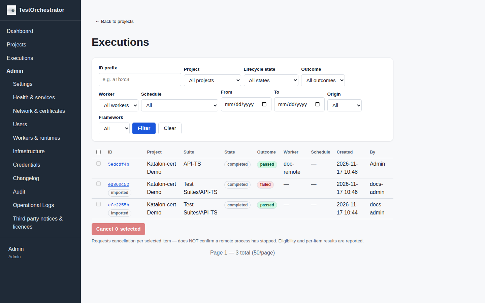

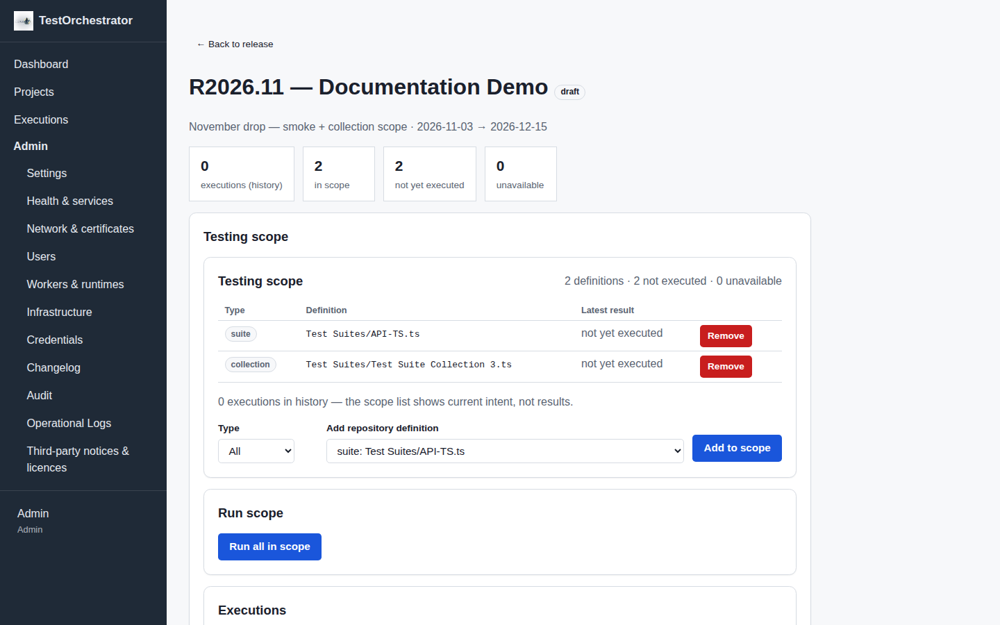

## 17. Storage lifecycle and capacity

| Data dir entry | Class | Grows with | Cleanup |
|---|---|---|---|
| `testorchestrator.db` | required state | history, imports, audit | never delete manually — vacuum via backup |
| `licence.json`, `secret.key`, `certs/` | required state | never | never — losing `secret.key` orphans every stored credential |
| `bindings/` | derived state | repo size × bindings | re-sync rebuilds; safe to rebuild, wasteful to delete |
| `imported-evidence/` | required state | imported runs | `toctl evidence-prune` (orphans only) |
| `remote-runs/` | required state | live executions | evidence-prune for orphans; keep referenced dirs |
| `import-staging/` | **transient** | in-flight imports | abandoned candidates expire — safe to prune per §9.4 |
| `dagu/` | required state | dag definitions + history | managed by coordinator |
| `workspaces/` (on worker) | **transient** | concurrent runs | worker-side; safe to clear stopped run dirs |
| `payload/reporting-labs/gen-*/` | derived output | report regenerations | older generations pruned per §9 |
| service logs (`journald`, `data/*.log`) | diagnostic | traffic | journald rotation; `logs_retention_days`/`logs_max_rows` bound the in-app operational log |

Automatic: operational-log bounds (`logs_retention_days`,
`logs_max_rows`), report-generation pruning, import-staging expiry.
**Manual**: evidence orphans (`toctl evidence-prune` — dry-run
first), worker workspaces, OS log rotation.

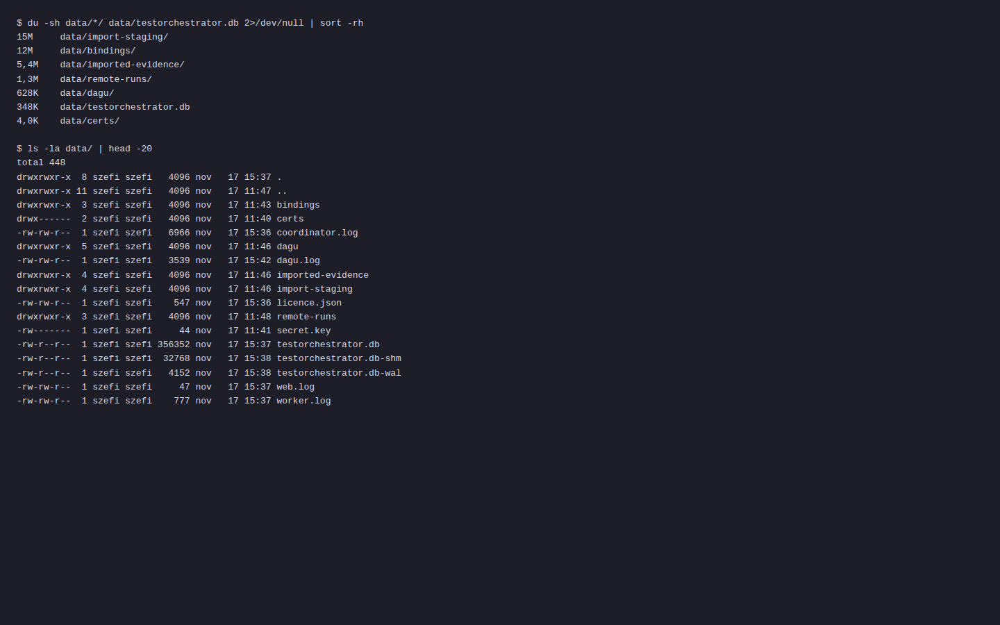


Backup ≠ export ≠ pruning: backup preserves *everything* for
restore; export publishes selected evidence to a repo; pruning
*deletes* unreferenced files. Don't prune to "save" a backup.

## 18. Worker maintenance and failure recovery

| Task | Supported procedure |
|---|---|
| Take a worker offline safely | **Drain** on its runner row — stops new claims; in-flight executions finish. Then stop the process. |
| Active execution during worker restart | The portal holds the lease; heartbeats renew it. If the lease **expires**, the execution is reconciled to **`UNKNOWN`** — never silently re-dispatched or double-run. Inspect it and rerun manually. `UNKNOWN` still consumes the runner's capacity slot until resolved. |
| Coordinator restart | Queued work is durable (outbox). Workers reconnect and resume claiming; running executions follow the lease rule above. |
| Stale registration | A stopped worker shows its last-seen heartbeat (>~2 min = not live). No auto-purge — **Edit**/**delete** the runner record deliberately. |
| Interrupted result transfer | The worker keeps the run directory; results stay `UNKNOWN`/`running` until transfer completes or the lease expires — never partially marked passed. |
| Replace a worker host | Drain → decommission → register the new runner (§12.1) reusing the `kre=<label>` so runtimes rebind automatically. |
| Update the worker binary | Download the portal-served package (always the coordinator's pinned Dagu version — no drift), stop the worker, replace, restart with the same labels/credentials. |
| Decommission | Drain → stop → delete the runner record → remove the host's credentials file and `workspaces/` — token re-issue revokes the old one (§12.1 step 2). |

Not implemented: automatic worker updates, auto-drain on version
mismatch, re-dispatch of `UNKNOWN` executions — each is a manual,
audited decision by design.

## 19. Credential and certificate lifecycle

| Secret | Lives | Replace/rotate | Restart needed |
|---|---|---|---|
| Repository deploy key/token | **Credentials** (encrypted under `secret.key`) | Edit the credential; bindings pick it up next sync | no |
| Worker agent token | runner record — SHA-256 only | **Issue token** re-generates; old token revoked | worker restart with new token |
| Coordinator credential | `config/dagu/credentials` (0600) + portal `dagu_credential_ref` | update both together — provision via `TO_DAGU_PROVISION_PASSWORD` at install or rotate manually | dagu + web |
| KRE licence/API key | **worker host only** (never the portal — `credential_file` carries just a path) | on the worker per Katalon's docs | worker executions pick it up next run |
| TLS certificate | `data/certs/` + `certificate_*` settings | **Network & certificates** → generate/import → Apply (`previous_good` rollback if the new config breaks) | via staged apply |
| `TO_SECRET_KEY` | `web.env` | rotate only if you're willing to invalidate all sessions | web |
| `secret.key` | `data/secret.key` (0600) — **master key for stored secrets** | no rotation supported — losing it = re-enter every credential | n/a |

After a restore: every stored secret returns intact **only if**
`secret.key` was backed up — the DB alone cannot decrypt them.

### 19.1 Private-repository access — three separate auth contexts

Each is configured and consumed separately — do not conflate them:

| Stage | Where auth is configured | How it is consumed |
|---|---|---|
| Portal-side git ops (binding sync, case/suite listing) | stored `user:token` SecretRef (HTTPS) or host ssh | portal backend only |
| Worker-side source checkout | `git_ssh_key_path` on the runtime — a path **on the worker** | worker's git SSH checkout; key material never crosses the wire |
| Evidence publishing | `publish_repo_url` + publish credential (portal-side) | portal export write + read-back + delete probe |

Worker-side prerequisites — the portal cannot provision the deploy
key. The administrator must:

1. Install a keypair on the **worker host** and authorize its public
   key on the repository host (deploy key / SSH access).
2. Supply the key's on-worker path as `git_ssh_key_path` in the run
   configuration — the spec references the *path*, never the material.
3. Keep the repository host in the worker's `known_hosts` — SSH host
   verification stays ON.

Rotating the key material at the same path is invisible to the portal
— re-verify after rotation; the worker is the source of truth for key
validity. Portal-side secret-rotation coverage does NOT extend to
worker key changes.

Verification semantics: "source binding resolved" proves **portal**-side
access only — remote capability additionally requires an `ssh://` /
`git@host:` binding, an eligible worker, and a verified engine on it;
the worker launch-verifies its own access. The publishing write probe
is a *verification* operation (marker ref created/read/deleted) — an
execution's evidence export is a different, later operation.

## 20. Version and upgrade matrix

| Path | Platform | Evidence | Migrations | Notes |
|---|---|---|---|---|
| 2.0.1 → 2.0.2 | Linux | **[verified]** interactive upgrade | `db-upgrade` applies; idempotent | history/config/evidence preserved |
| 2.0.1 → 2.0.3 | Linux | **[code/CI]** `upgrade-from-v201` job | auto via installer + `db-upgrade` | skips 2.0.2 — fine; includes repair below |
| 2.0.2 → 2.0.3 | Linux | **[verified]** CI `upgrade-from-v202` + the live doc environment upgraded this way | auto | **automatically repairs the 2.0.1/2.0.2 reportingLabs omission** and removes a superseded root-level `payload/reporting_labs` |
| 1.0.2 → 2.0.3 | Windows | **[code/CI]** `upgrade-from-v102` | auto | |
| 2.0.2 → 2.0.3 | Windows | **[code/CI]** `upgrade-from-v202` | auto | |

Rules: **back up `data/` first** (§16). Re-running the installer on
the same directories performs the in-place upgrade; running an app
directly from an **extracted tarball root** is *not* an install —
the 2.0.1/2.0.2 reportingLabs defect never appears there because the
tarball root itself is on `sys.path`, which is exactly what masked
it. Rollback = restore the pre-upgrade backup; there are no
downgrade migrations. Retired paths: 2.0.0 → * (source release was
removed; historical results preserved in prior run logs).

## 21. Incident runbooks

Symptom → first checks. Exact commands/paths, no database surgery.

| Symptom | Investigation path |
|---|---|
| Portal unavailable | `systemctl status testorchestrator-web` (or the running waitress pid) → `journalctl -u testorchestrator-web -n 50` → bind (`TO_WAITRESS_LISTEN`) → Caddy `systemctl status testorchestrator-caddy` + cert validity |
| Worker absent | process on host → coordinator reachability (`--worker.coordinators` host:port) → credentials file (0600) → runner row heartbeat (>~2 min stale) → worker log |
| Job stays `queued` | licence state (**System → Licence** — held queue needs licence + **Resume dispatch**) → live worker with matching `kre=<label>` → free slots (concurrency on runner + runtime) → overlap policy on schedules |
| KRE exits before tests | executable path **on the worker** → file permissions → `Activation failed` = worker-side KRE licence → remote run log for the exact exit |
| Execution done, results missing | worker run dir → transfer errors in coordinator/worker logs → `remote-runs/` evidence dir → execution row state (`UNKNOWN` = transfer/lease gap) |
| reportingLabs generation fails | `report_status` on the execution → generation log → `import reporting_labs` resolves from `payload/3rdparty/` → `reportinglabs_enabled` setting → input JUnit/evidence present |
| Import can't be confirmed | candidate row state → staging checkout expiry → per-item match decision (duplicate/ambiguous) → importer errors in operational log |
| Disk filling | `du -sh data/*/` → `import-staging/` (expired candidates) → workspaces on workers → `reporting-labs/gen-*` generations → journald size → `toctl evidence-prune` dry-run |
| `403` for everyone | host alias vs bare IP — `allowed_hosts`; loopback gate until `setup_completed` + `external_enabled` |
| Sessions drop on restart | `TO_SECRET_KEY` unset/changed — pin it in `web.env` |
| `UNKNOWN` executions | lease expired mid-run — inspect run log, verify results on the worker, rerun deliberately; the slot frees on resolution |
