# TestOrchestrator 2.5.0 — User Manual

Applies to **TestOrchestrator 2.5.0** (verified build commit
`1adf71b8d5f8`).

All screenshots were captured from a real Linux installation of the
published release package using safe demonstration data. Where a
fixture stood in for licensed software, that is stated on the
screenshot caption and in the text.

---

## Contents

- [1. Introduction](#1-introduction)
  - [1.1 What TestOrchestrator does](#11-what-testorchestrator-does)
  - [1.2 Components and their responsibilities](#12-components-and-their-responsibilities)
  - [1.3 Live execution vs. historical-result import](#13-live-execution-vs-historical-result-import)
  - [1.4 Signing in](#14-signing-in)
  - [1.5 Roles and permissions](#15-roles-and-permissions)
  - [1.6 Navigation](#16-navigation)
- [2. Projects and repositories](#2-projects-and-repositories)
  - [2.1 Creating a project](#21-creating-a-project)
  - [2.2 Configuring a repository binding](#22-configuring-a-repository-binding)
  - [2.3 Discovery: what sync finds](#23-discovery-what-sync-finds)
  - [2.4 Suites, schedules, and releases](#24-suites-schedules-and-releases)
- [3. Step by step — suites, releases, and plans](#3-step-by-step--suites-releases-and-plans)
  - [3.1 Create and edit a test suite](#31-create-and-edit-a-test-suite)
  - [3.2 Create and manage a release](#32-create-and-manage-a-release)
  - [3.3 Create a plan (schedule)](#33-create-a-plan-schedule)
- [4. Connecting KRE and running tests](#4-connecting-kre-and-running-tests)
  - [4.1 What must exist first](#41-what-must-exist-first)
  - [4.2 Starting a suite or collection](#42-starting-a-suite-or-collection)
  - [4.3 Monitoring an execution](#43-monitoring-an-execution)
  - [4.4 Cancellation, retry, and deletion](#44-cancellation-retry-and-deletion)
  - [4.5 Reading outcomes: test failure vs. infrastructure failure](#45-reading-outcomes-test-failure-vs-infrastructure-failure)
  - [4.6 The application-licence notice](#46-the-application-licence-notice)
- [5. Historical-result import](#5-historical-result-import)
  - [5.1 Starting an import](#51-starting-an-import)
  - [5.2 The preview](#52-the-preview)
  - [5.3 Confirming](#53-confirming)
  - [5.4 Provenance](#54-provenance)
  - [5.5 Warnings and missing evidence](#55-warnings-and-missing-evidence)
  - [5.6 Retrying a failed candidate](#56-retrying-a-failed-candidate)
- [6. Reports and evidence](#6-reports-and-evidence)
  - [6.1 Execution history](#61-execution-history)
  - [6.2 reportingLabs reports](#62-reportinglabs-reports)
  - [6.3 Evidence](#63-evidence)
  - [6.4 Troubleshooting missing or incomplete results](#64-troubleshooting-missing-or-incomplete-results)
- [7. Fixture-vs-licensed statement for these screenshots](#7-fixture-vs-licensed-statement-for-these-screenshots)

---

## 1. Introduction

### 1.1 What TestOrchestrator does

TestOrchestrator is a self-hosted portal that schedules, dispatches,
and records automated test runs for Katalon Studio projects:

- It checks out a bound Git repository, discovers test cases, test
  suites, and test-suite collections, and launches them through
  **Katalon Runtime Engine (KRE)**.
- Execution is delegated through **Buildbot** to registered
  **execution targets**, so tests run next to the KRE
  installation that owns them.
- Results — JUnit outcomes, logs, screenshots, and native Katalon
  reports — are collected back and stored as **evidence** attached to
  a durable **execution** record.
- **reportingLabs** generates a browsable HTML report per execution
  from the stored results.
- Katalon results that were produced elsewhere (an older CI job, a
  teammate's machine, an archive) can be **imported** into history
  with full provenance instead of re-run.

### 1.2 Components and their responsibilities

| Component | Role |
|---|---|
| **TestOrchestrator portal** | Web UI + API. Owns projects, Git bindings, users, the execution database, evidence, and reports. Serves the worker installer and the Linux worker archive to authenticated users. |
| **Buildbot master** | Bundled orchestrator (v4.3.0). Accepts dispatched jobs from the portal and hands them to the selected execution target. Its REST API is loopback-only. |
| **Execution target** | A local controller worker, a remote `buildbot-worker` (Windows/Linux), or an agentless SSH host. Managed entirely in Admin → Infrastructure. |
| **KRE** | Katalon Runtime Engine — the licensed test executor. It must be installed and licensed **on the worker/host** where the suite actually runs. TestOrchestrator invokes it; it does not license it. |
| **reportingLabs** | Bundled report generator (vendored, MIT). Converts stored results + evidence into a static HTML report per execution. |

The portal never executes tests itself when a remote runtime is
selected — the target does. The portal orchestrates, records, and
serves the results.

### 1.3 Live execution vs. historical-result import

Two paths create execution records:

- **Live execution** — a suite or collection is dispatched now: the
  worker checks out the bound revision, runs KRE, and returns
  results and evidence. Use this to *run* tests.
- **Result import** — an existing `Reports/` tree inside the bound
  repository is scanned at a chosen revision; matching JUnit output
  becomes imported executions with provenance (source commit, run
  directory, parser). Use this to *adopt* results that already exist.
  Importing cannot invent evidence that is not in the result files —
  it stores what is there and reports what is missing.

### 1.4 Signing in

Open the portal URL your administrator gives you (for example
`https://tests.example.com/`). You land on the sign-in page.

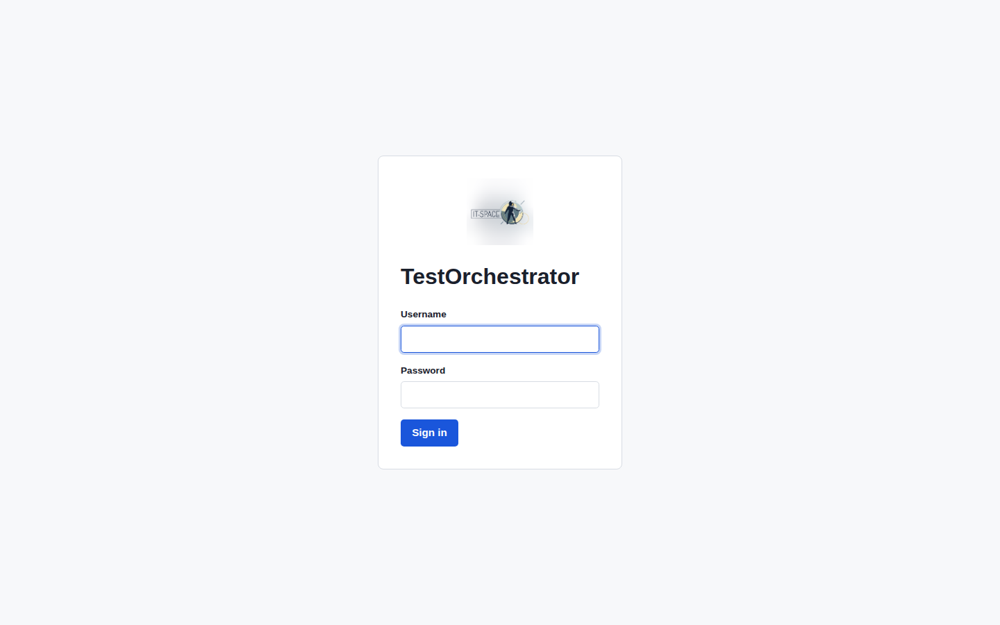

- On a **fresh installation** a bootstrap account `Admin`/`Admin`
  exists. The first sign-in with it is forced directly to the
  password-change form — you cannot navigate anywhere until a strong
  password (at least 12 characters) replaces the temporary one.
- Until the administrator marks setup complete and enables external
  access, the portal only accepts connections from the machine it
  runs on (loopback). If you get an unexpected `403`, ask your
  administrator — this is the intended gate, not an error.
- The portal only answers under its configured host names. Bookmark
  the address you were given rather than a raw IP.

Sign out with the sign-out control in the sidebar footer.

### 1.5 Roles and permissions

Four roles exist. The sidebar shows only what your role may use.

| Capability | Admin | Test Manager | Tester | PO |
|---|---|---|---|---|
| Sign in, view dashboard, projects, executions, reports | ✓ | ✓ | ✓ | ✓ |
| Queue executions (run suites/collections) | ✓ | ✓ | ✓ | — |
| Import historical results | ✓ | ✓ | — | — |
| Edit projects, bindings, schedules; delete executions | ✓ | ✓ | — | — |
| System pages: settings, users, workers, credentials, network, audit, logs | ✓ | — | — | — |

Passwords must be at least 12 characters. An administrator can reset
your password to a temporary value — you will be forced to replace it
at next sign-in (`must_change_password`).

### 1.6 Navigation

The left sidebar is the whole application:

- **Dashboard** — live tile overview (projects, active/queued
  executions, 30-day outcomes, worker eligibility) plus outcome and
  duration charts.
- **Projects** — your projects; each leads to bindings, discovered
  inventory, suites, schedules, imports, and releases.
- **Executions** — the global execution history with filters.
- **Admin** (administrators only) — Settings, Health & services,
  Network & certificates, Users, Workers & runtimes, Infrastructure,
  Credentials, Changelog, Audit, Operational Logs, Third-party
  notices & licences.

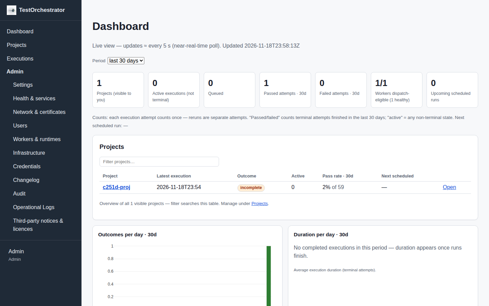

---

## 2. Projects and repositories

A **project** groups everything about one test codebase: its Git
binding(s), discovered inventory, executions, schedules, imports, and
report publication.

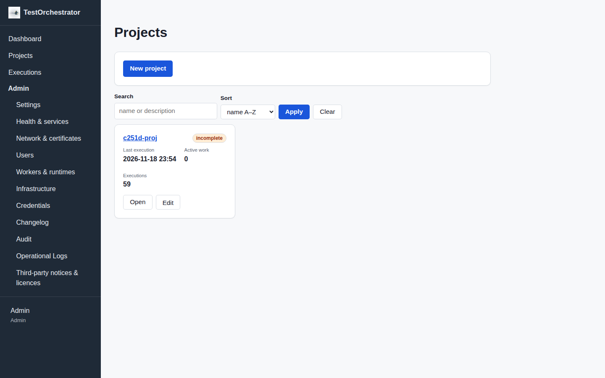

### 2.1 Creating a project

**Projects → New project.** Give it a name and optional description.
The project page then offers a **Git binding**: the repository that
contains the Katalon project.

### 2.2 Configuring a repository binding

On the project page, add a binding with:

- **Name** — a label for this binding (a project can have several,
  e.g. a sources repo and a results repo).
- **URL** — a remote Git URL (`https://…`, `git@…`) or a local path.
- **Ref** — branch, tag, or other ref the binding tracks
  (e.g. `master`).
- **Subdirectory** — optional path inside the repo that is the Katalon
  project root, if the repo holds more than the project.
- **Credentials** — for private repositories, reference a credential
  stored under **Admin → Credentials** (`git` kind: an HTTPS token or
  SSH private key). Stored values are write-only — they are never
  shown back, logged, or exported.
- **Report write-back** — off by default; an admin can explicitly
  opt a binding in to push generated `TestOrchestrator/Reports/`
  output back to a named branch. Read access is not publish
  permission — nothing is pushed unless this is enabled.

After saving, **sync** the binding. Sync clones/fetches into an
internal worktree and resolves the revision to an exact commit SHA —
every execution records that SHA, so runs are reproducible.

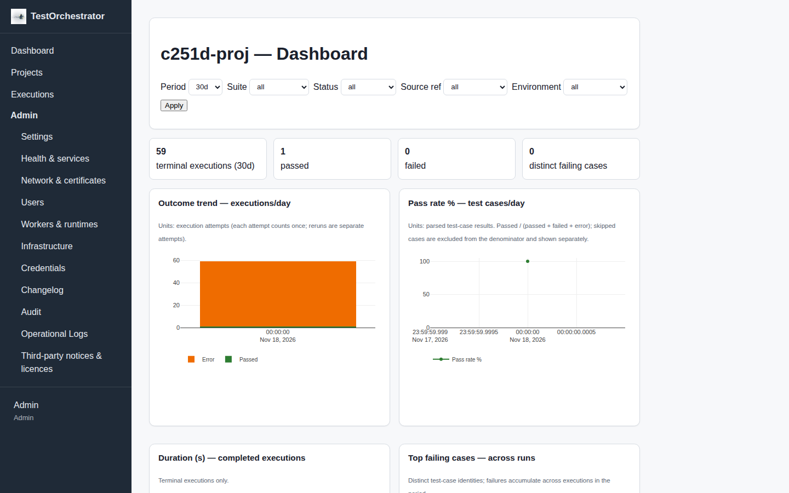

### 2.3 Discovery: what sync finds

After a successful sync the binding is scanned for a Katalon
project: exactly one `*.prj` file, `Test Cases/*.tc`,
`Test Suites/*.ts` (split into **suites** and **collections** by their
XML root element — not by file name), and `Profiles/*`. The
inventory is replaced atomically per resolved SHA: a failed sync
keeps the last good inventory marked stale rather than emptying it.

Typical diagnostics:

| Symptom | Meaning |
|---|---|
| `no Katalon .prj file found under the bound path` | The binding root or subdirectory does not point at a Katalon project. Fix the subdirectory. |
| `multiple .prj files` | The bound scope contains several projects — narrow the subdirectory. |
| `symlink escape skipped` | A link inside the repo pointed outside the checkout; it was ignored. |
| `bound worktree/subdirectory missing` | The binding was never synced, or the worktree was cleaned. Sync again. |

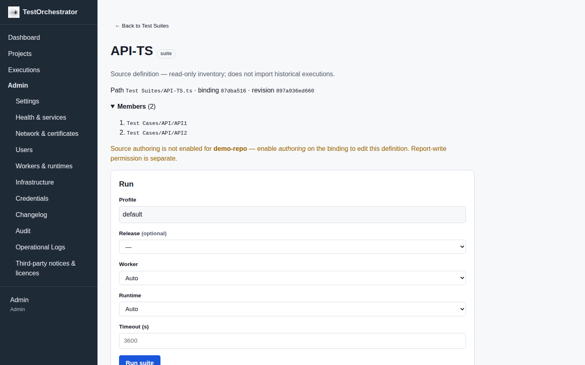

Repository access failures (authentication, unreachable host, bad
ref) surface on the binding with the underlying error. Check the URL,
the credential reference, and that the ref resolves — an invalid ref
reports `cannot resolve '<ref>'`.

> **Provider note.** Git hosting is accessed through a generic Git
> backend; HTTPS-token and SSH authentication are supported.
> **Azure DevOps repositories specifically are an open backlog
> item** — interoperability has not been validated because no
> authorized ADO host was available. Treat ADO URLs as unverified
> until that gate is closed.

### 2.4 Suites, schedules, and releases

- **Suites** — a portal-side grouping you can compose from discovered
  items, edit, and run as a unit.
- **Schedules** — recurring launches of a suite/collection; they can
  be toggled, edited, or triggered once on demand.
- **Releases** — a scoped set of items tracked toward a release with
  its own run and status view.

Step-by-step procedures for all three are in §3.

---

## 3. Step by step — suites, releases, and plans

This section walks each authoring flow end to end. Who may do what:

| Action | Admin | Test Manager | Tester | PO |
|---|---|---|---|---|
| Create / edit suites, releases, schedules | yes | yes | no | no |
| Run suites / releases / run-now schedules | yes | yes | yes | no |
| View everything | yes | yes | yes | yes |

### 3.1 Create and edit a test suite

A suite is an ordered, portal-side list of test cases taken from a
project's repository binding. It versions on every save and carries a
content hash so the portal can show when the repo definition drifts.

**Create:**

1. Open the project → **Suites** → **New suite**.
2. Fill the fields:
   - **Suite name** — required (≤128 chars). Submitting without one
     returns to the form with an error; nothing is half-created.
   - **Description** — optional free text.
   - **Source binding** — which repository binding's discovered cases
     the selector lists (when the project has several).
   - **Test cases** — multi-select from the cases that sync
     discovered (§2.3). Order of selection is the suite order;
     duplicates are collapsed on save.
3. Submit. The portal validates **every** selected ref against the
   binding's current case list — a case that no longer exists in the
   repository is reported by name and the suite is not created
   partially.

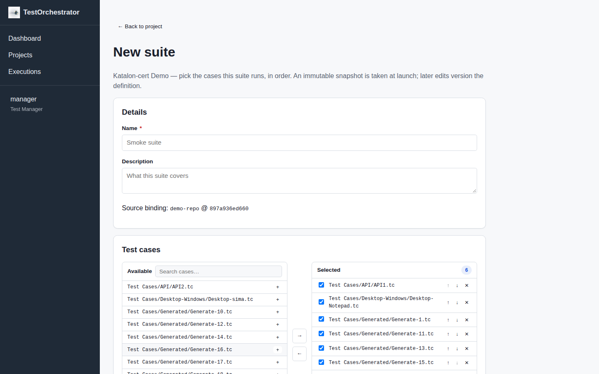

Once saved, the suite page shows the ordered entries, the current
version and content hash, sync status, and the run controls:

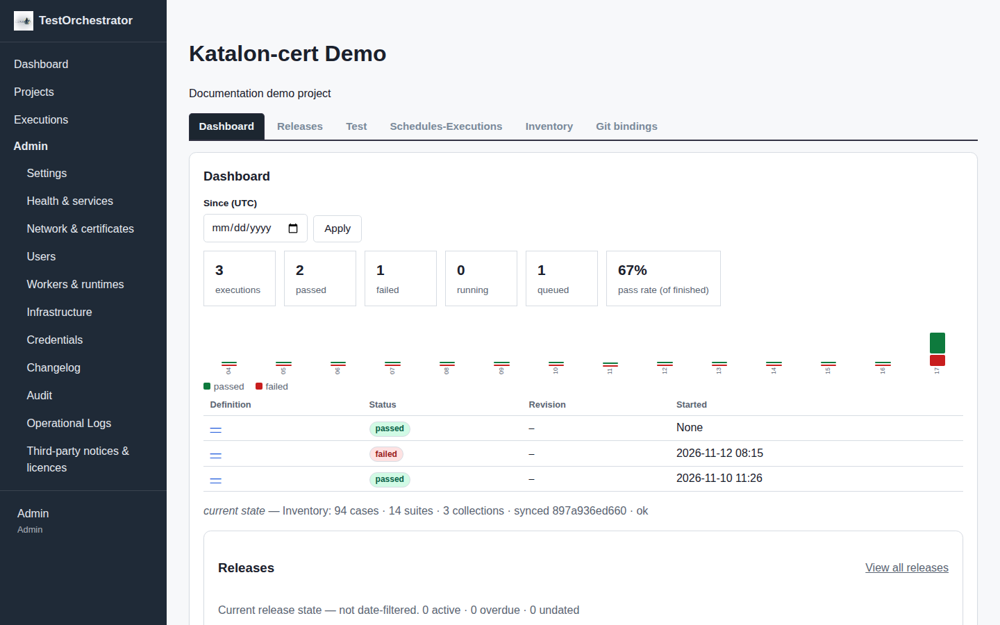

**Edit:**

1. Open the suite → **Edit**. The selector shows the saved order;
   cases that disappeared from the repository remain visible so you
   can remove them deliberately.
2. Saving replaces the entry list wholesale in selector order and
   bumps the suite **version**; the content hash is recomputed.
3. A suite flagged **read-only** (e.g. a definition authored in and
   imported from the repository) refuses edits — change it at the
   source and sync instead.
4. **Sync to repo** writes the suite definition back into the bound
   repository — only for bindings with source authoring enabled
   (§2.2).

**Run:** from the suite page, **Run** opens the execution form —
see §4.2 for every field. Submission re-checks that the pipeline is
actually operational (a registered worker + KRE installation must
exist *now*, not only at setup time); if something is missing the
portal names it and sends you to setup instead of queuing a doomed
run.

### 3.2 Create and manage a release

A release tracks a fixed scope of repository items (suites and
collections) toward a target, with its own run and roll-up status.

**Create:**

1. Open the project → **Releases** → **New release**.
2. Fields:
   - **Name** — required.
   - **Description** — optional.
   - **Start date** / **Target end date** — ISO `YYYY-MM-DD`;
     the end date must be on or after the start date or the portal
     rejects it.
3. The release page opens. It has three parts: the **scope table**,
   the **run history** linked to the release, and **add-to-scope**
   controls.

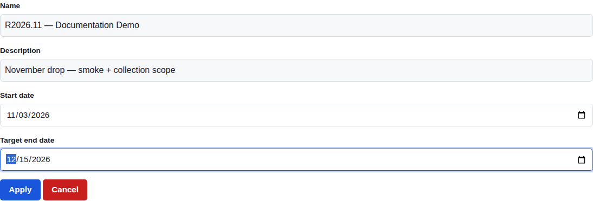

**Build the scope:**

1. In *Add to scope*, pick from the project's discovered **suite**
   and **collection** items and add them — the picker also lists
   discovered test cases for completeness, but adding a case is a
   no-op: scope is suite/collection only. Each row stores the
   item's kind, repository path, and the discovered item it was
   taken from.
2. **Remove** on a scope row drops it.
3. Scope rows show a live state per item:
   - `not yet executed` — no matching run yet;
   - the **outcome of the latest execution** — matched by target
     *and* run configuration (profile, browser, runner, runtime), so
     a pass under one profile does not hide a failure under another;
   - `unavailable — definition removed from repository` — the
     discovered source item was deleted upstream; the scope row keeps
     the last-known path for traceability.

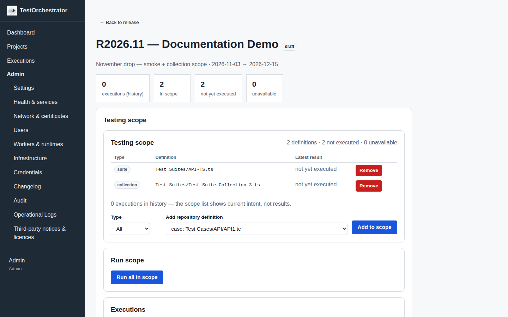

4. **Edit** on the release updates name, description, and dates.

**Sync the release manifest to the repository:**

1. **Sync preview** shows the manifest file the portal would write
   into the release's bound repository (single-binding scope only —
   a scope spanning multiple bindings reports that it cannot sync).
2. **Sync** commits the manifest to the repo and records the written
   path on the release. Any scope or metadata change flags the
   release as sync-dirty until the next sync.

**Run the release:**

1. **Run** queues **one execution per in-scope item** with the run
   form's configuration — execution profile, browser, runner, KRE
   installation (§4.2). Every queued execution is linked to the
   release, which is what the roll-up counts.
2. The portal flashes how many executions were queued; watch them on
   the release page or **Executions**.
3. You can also attach an existing execution retroactively — open the
   execution → **Link release**.

**Roles:** creating, editing, and scope/sync actions need Admin or
Test Manager; running needs any of Admin / Test Manager / Tester.

### 3.3 Create a plan (schedule)

A schedule fires a target automatically — once at a set time or on a
repeating interval. Targets are either a discovered repository item
or a portal suite.

**Create:**

1. Open the project → **Schedules** → **New schedule**.
2. Fields:
   - **Schedule name** — required.
   - **Runs** (target) — pick **one** entry via the two-panel
     selector: a discovered repository item (`suite · path` /
     `collection · path`) or a portal suite. Only one target is
     persisted per schedule — to run several, create a portal suite
     or a collection first. Repository items resolve to their
     current repo path at fire time.
   - **Kind** — `Once` (single run) or `Repeating`.
   - **First run (UTC, `YYYY-MM-DD HH:MM`)** — required for `Once`;
     on `Repeating` a blank means "start now".
   - **Every N minutes** — repeat interval, minimum 5 (default 60).
   - **Execution profile** — free-form profile tag (default
     `default`); becomes part of the run's configuration key.
   - **Browser** — one of the supported KRE browser modes
     (default `Chrome (headless)`).
   - **Remote WebDriver URL / driver type** — only for runs steered
     at an external WebDriver grid.
   - **Timeout (seconds)** — per-run cap, default 3600.
   - **Runner** — `Auto` (any suitable) or a pinned worker.
   - **KRE installation** — `Auto` or a pinned runtime connection.
   - **Overlap** — `Allow overlap` or `Skip if previous run active`
     (a firing is skipped while the previous execution of this
     schedule is still running).
3. Submit — the schedule is created **enabled**.

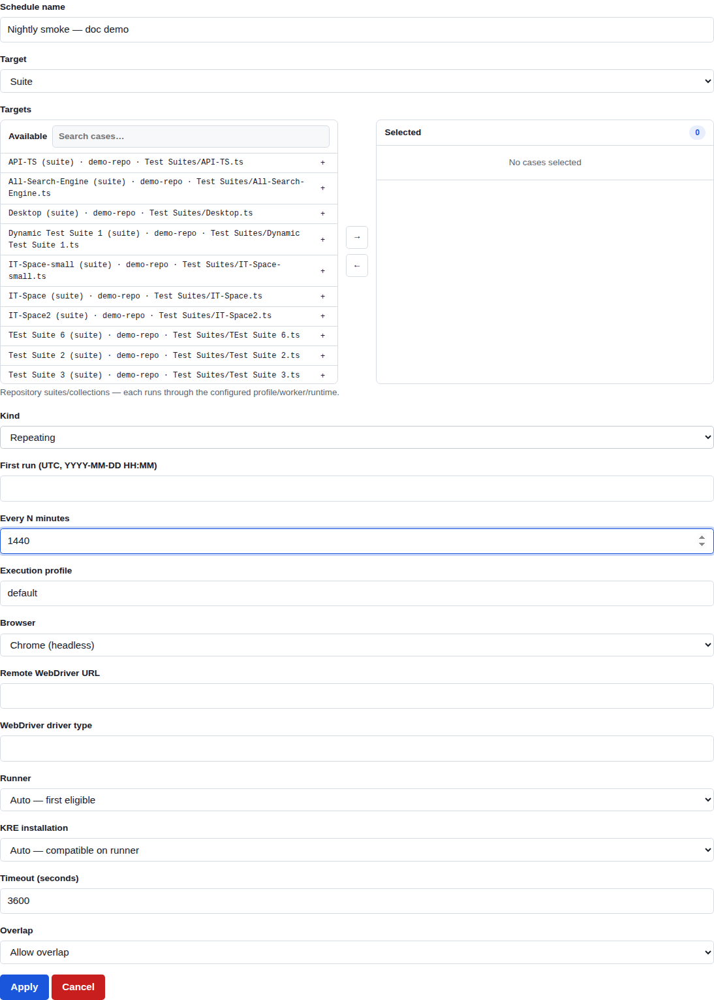

**Operate:**

- **Toggle** pauses/resumes it. Re-enabling a schedule that has no
  next run time schedules it to fire immediately.
- **Edit** changes name, timing, run configuration, and repository
  targets — history is preserved; already-created executions are
  untouched.
- **Run now** fires it once on demand (independent of its clock).
- **Delete** removes the schedule only — executions it created stay.

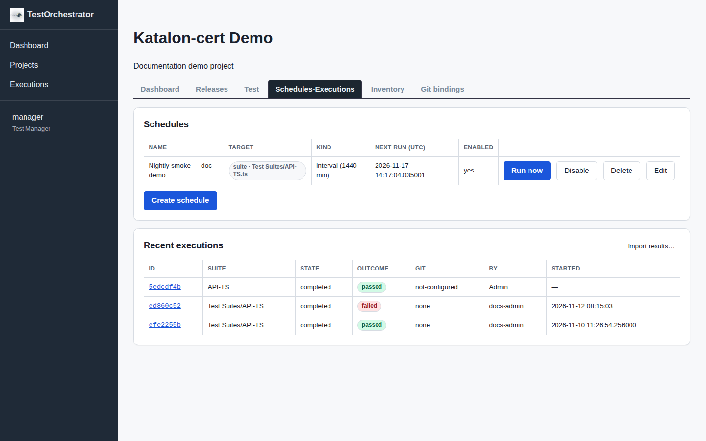

Missed/blocked targets surface the same way as manual runs — check
**Executions** for the fired runs and §4.5 for failure semantics.

---

## 4. Connecting KRE and running tests

### 4.1 What must exist first

A run needs all of the following — an administrator sets these up
(**Admin → Infrastructure** and **Admin → Workers & runtimes**):

1. **A runner** — an execution-target destination. `remote` runners
   are Buildbot workers or agentless SSH targets.
2. **A registered target** — an enabled execution target in
   coordinator, advertising labels such as `kre=<label>` (plus
   automatic `os`/`arch` labels).
3. **A runtime connection (KRE installation)** — the registered path
   to a KRE executable *on that target*, its workspace root, and the
   runner binding that selects the target.

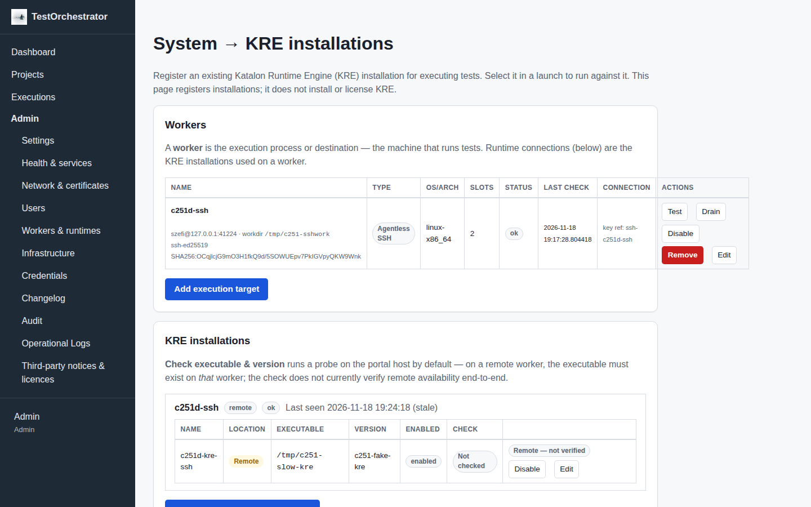

> **KRE licences.** Katalon Runtime Engine requires a valid Katalon
> licence or API key *on the execution host*. TestOrchestrator
> passes invocation through but cannot supply the licence —
> `kre-exec`/`kre-smoke` verify the binary only as far as launch.
> A run that reaches KRE activation without a licence fails with a
> recorded activation error (see §4.5) — that is an environment
> problem, not a portal defect, and it is never silently turned
> green.
>
> In this documentation environment a **fixture** stood in for KRE
> (a script emitting genuine Katalon-format output), so every screen
> showing a live run is labelled accordingly. Licensed execution was
> not validated here.

### 4.2 Starting a suite or collection

From the project's discovered inventory, open a **suite** or
**collection** item and choose **Run**. The form offers the actually
implemented settings:

- **Execution profile** — the Katalon profile name (`default` if
  empty).
- **Runner** — which configured runner to dispatch to.
- **Runtime (KRE installation)** — which registered executable the
  worker should invoke.
- **Timeout** — seconds before the run is considered timed out.

Confirm to queue the execution. You are taken to the execution detail
page.

### 4.3 Monitoring an execution

The execution page shows lifecycle state, outcome, worker, suite,
timestamps, a results table, artifacts, and provenance.

States you will see: `queued` → `dispatched`/`running` → a terminal
state (`completed`, `failed`, `canceled`). A run you cancel sits in
`cancel_requested` until the coordinator confirms termination. A run
whose outcome the portal cannot determine lands in `unknown` — that
is honest uncertainty, never silently retried; check its error text
and audit trail before deciding to rerun it manually. **Outcome**
(`passed`, `failed`, …) is computed from the returned test results —
it is distinct from the lifecycle state. A run can be `completed`
with outcome `failed` (tests ran and failed) or `failed` with no
outcome (the machinery broke).

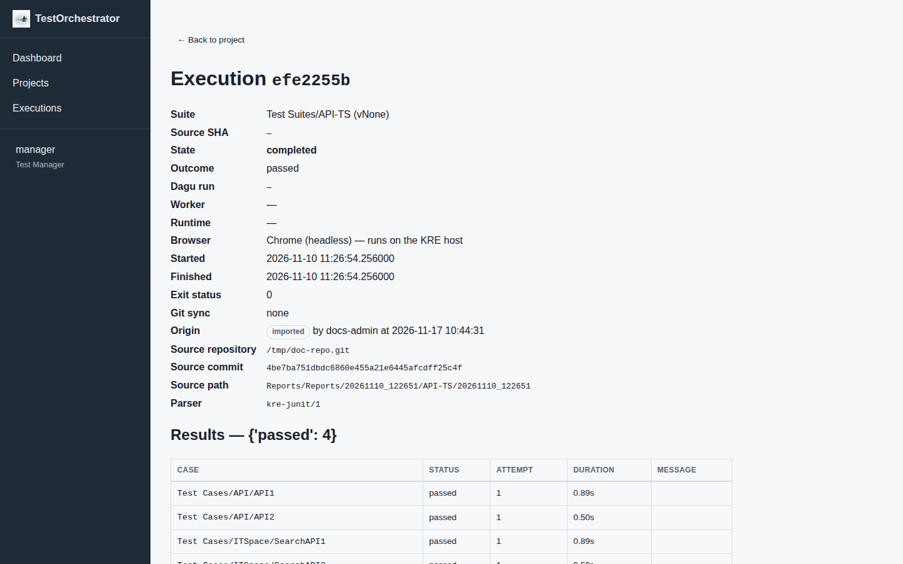

### 4.4 Cancellation, retry, and deletion

- **Cancel** — requests cancellation per selected execution (the bulk
  bar on the Executions page, or per execution). The execution moves
  to `cancel_requested` while the portal asks the coordinator to stop
  the workflow run; once the coordinator confirms the abort, the
  execution settles in terminal `canceled` and both steps appear in
  the audit trail. A cancel request is honored quickly — the brief
  `cancel_requested` window is the stop propagating, not a stuck
  state. If the coordinator itself was unreachable, the run can land
  in `unknown` instead of `canceled` — treat that as "termination
  unconfirmed" and check the audit trail.
- **Retry** — re-queues a finished execution with its recorded run
  configuration, linked as a new attempt.
- **Delete** — marks the execution for deletion. The portal first
  removes the published remote report copy, then the execution
  record, then its owned local evidence directories. Evidence that
  another execution still references is preserved (see
  Admin Manual §9).

### 4.5 Reading outcomes: test failure vs. infrastructure failure

| Symptom | Classification | What it means |
|---|---|---|
| `completed` + outcome `failed`, cases listed with `<failure>` messages | **Test failure** | KRE ran; assertions failed. This is a real test result. |
| `failed`, no cases, run log shows `No Offline License … Activation failed` | **Licence/activation failure** | KRE launched but could not activate — missing licence/API key on the target host. Not a test verdict. |
| `failed`, no cases, dispatch/checkout/workspace errors | **Infrastructure failure** | The job never reached test execution. |
| `incompleted`/partial results, `framework=unknown` artifacts | **Incomplete** | Output was cut short or produced by an unrecognized tool; treat with care. |

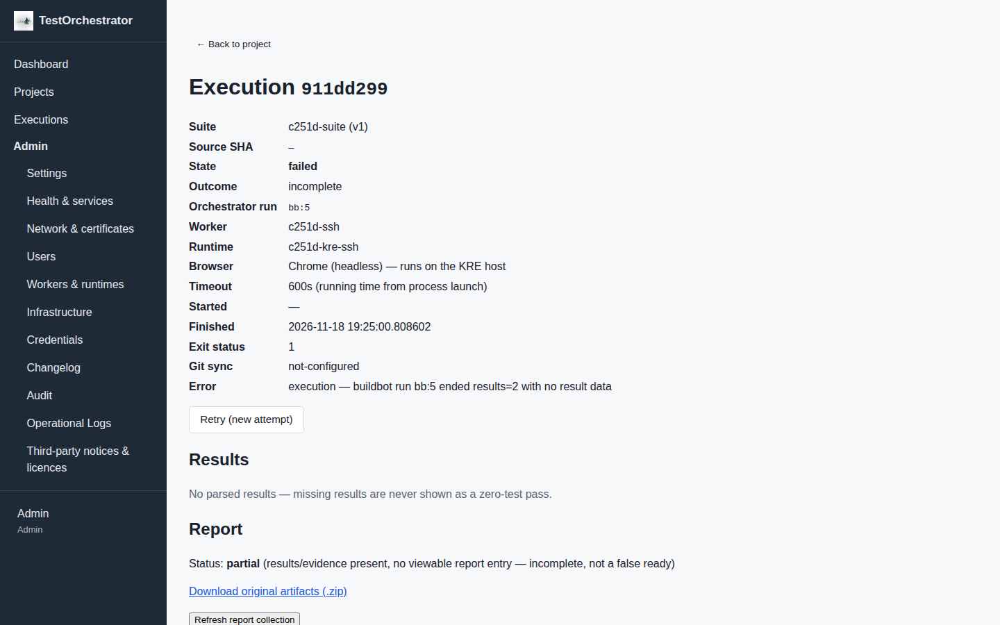

### 4.6 The application-licence notice

TestOrchestrator's own application licence is **informational
only** — it never blocks you. If the licence is missing, expired,
or otherwise not valid, the login page shows the notice:

> This version is not supported

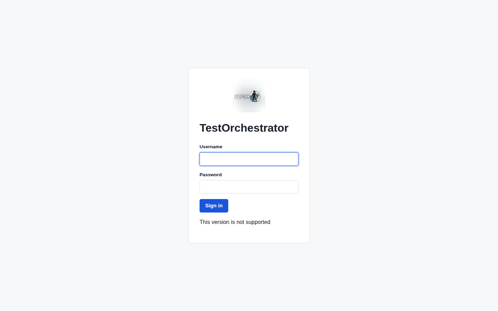

*Login with no valid application licence — tested on the 2.0.4
candidate; the notice is informational and sign-in works normally.*

That is all it does. You can still sign in normally and every
feature — projects, runs, schedules, imports, reports — works
exactly the same. Nothing is queued, held, or restricted. An
administrator can record a licence at **System → Licence** to clear
the notice, but is not required to.

This is the **application** licence — separate from the KRE licence
that must exist on each execution target (§4.1). An
`Activation failed` result (§4.5) means the target's KRE licence, not
the portal's application licence.

---

## 5. Historical-result import

Import adopts existing Katalon `Reports/` output into execution
history with provenance. It never rewrites what it imported.

### 5.1 Starting an import

On the project page choose **Imports → New import**. Pick the bound
repository, the **revision** (ref or `HEAD` — it is resolved to an
exact commit before scanning), and the **result directory** to scan
(typically `Reports`).

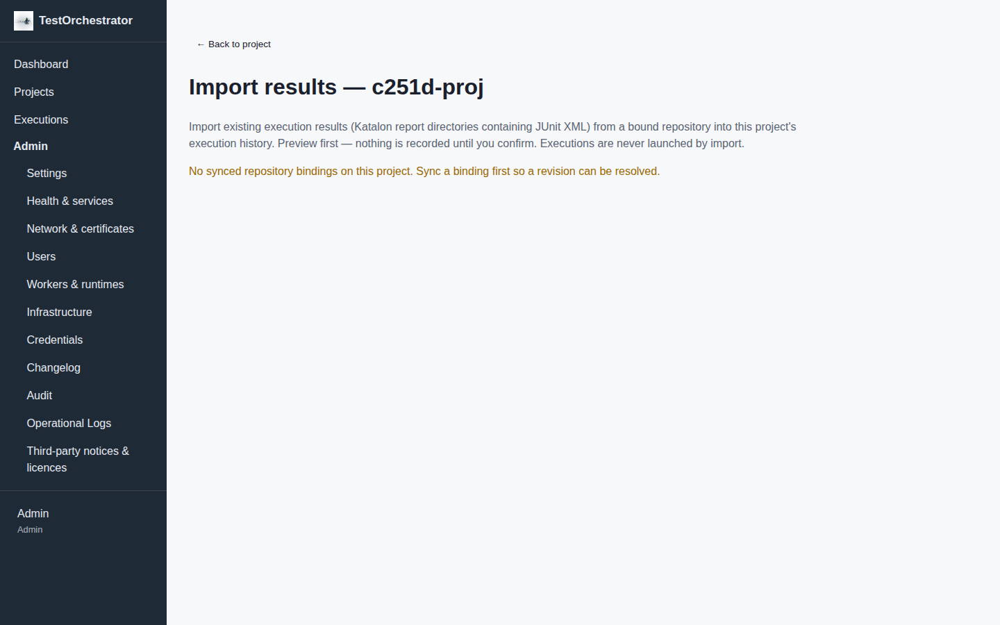

### 5.2 The preview

The preview materializes the chosen revision into a private staging
checkout (your working tree is never touched), detects every result
directory, parses its JUnit output, and **classifies** each candidate
against project history *before* anything is written.

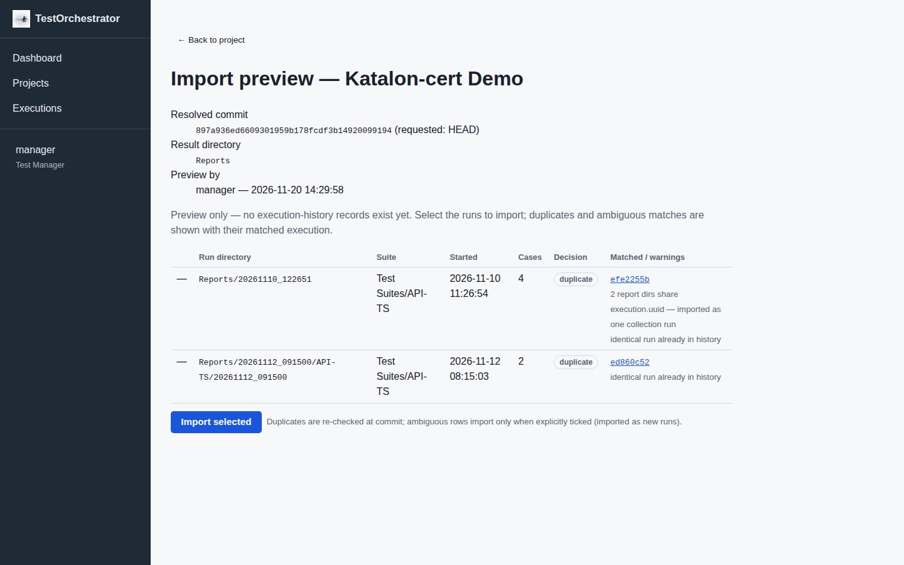

Decisions you will see:

| Decision | Meaning | On confirm |
|---|---|---|
| `new` | No matching run in history | Imported as a new execution |
| `duplicate` | Same run identity already imported (by `execution.uuid`, or by identical content) | Skipped — re-check at confirm time keeps it safe |
| `ambiguous` | Conflicting evidence (e.g. same identity, different content) | Only imported if you explicitly tick it; it is imported as a **new** run — never merged |
| `supplement` | Same run, with data the stored execution lacks (e.g. a collection suite that arrived later) | The missing pieces are merged into the existing execution |

Group behaviour:

- Report directories that share an `execution.uuid` are treated as
  **one collection run** — the preview groups them and confirms them
  as a single execution covering every member suite.
- A suite that appears in a **later** import of the same run becomes a
  `supplement` candidate: its cases, suite key, and files merge into
  the stored execution; existing data is preserved.
- Two runs with **different** `execution.uuid` values stay distinct
  executions — that is how reruns of the same suite are represented.
- JUnit files without a Katalon fingerprint and not matching any known
  producer are imported with `framework=unknown` — the run is kept,
  but flagged as an unidentified producer.

### 5.3 Confirming

Tick the candidates to import and choose **Import selected**.
Duplicates and ambiguous rows are re-checked at confirm time; two
administrators confirming the same candidate cannot create a double
execution (a per-project import lock serializes the recheck).

Confirmation is **not** an atomic batch: each candidate commits
independently. If something interrupts the batch, imported candidates
stay imported and pending/failed ones can be retried — the staging
checkout is retained while retryable candidates remain.

### 5.4 Provenance

Every imported execution records who imported it, when, the source
repository, the resolved commit, the source result path, and the
parser used (e.g. `kre-junit/1`). This is on the execution page and
inside its stored snapshot.

### 5.5 Warnings and missing evidence

Import reports what it could not do: unparseable files, missing
`execution.uuid` (matched by content instead), artifact files
referenced but absent, and cases whose evidence could not be mapped.
**Importing cannot recreate missing evidence** — if a log or
screenshot is not in the result directory, it is not in the imported
execution either; the warnings tell you exactly what is absent.

### 5.6 Retrying a failed candidate

A candidate that failed during confirm (parse error, transient
staging problem) stays on the preview with its failure and can be
re-confirmed — the staging checkout is deliberately kept until no
retryable candidates remain.

---

## 6. Reports and evidence

### 6.1 Execution history

**Executions** lists every run with filters for ID prefix, project,
lifecycle state, outcome, target, schedule, date range, origin
(live/imported), and framework. Fifty per page.

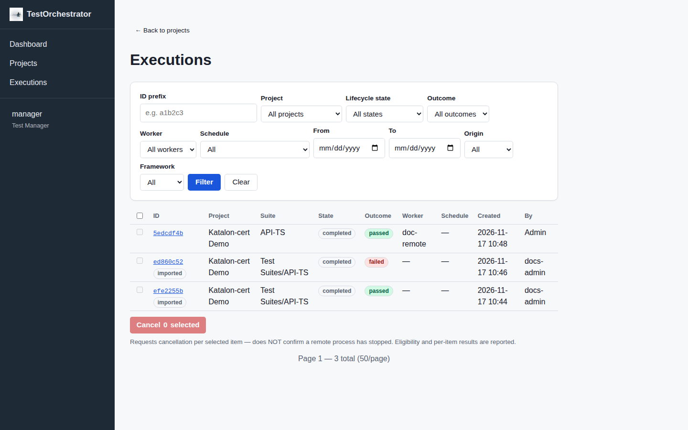

### 6.2 reportingLabs reports

An execution's **Report** view embeds the generated reportingLabs
HTML — overview, per-test status, failures, graphs, and timeline.

Report generation states (`rl_status`):

- `ready` — a generated report exists and is current.
- `missing` — nothing to generate from (no stored results/evidence).
- `failed` — generation attempted and failed; the error is recorded
  and **Regenerate** retries from stored results — it never touches
  the original artifacts.

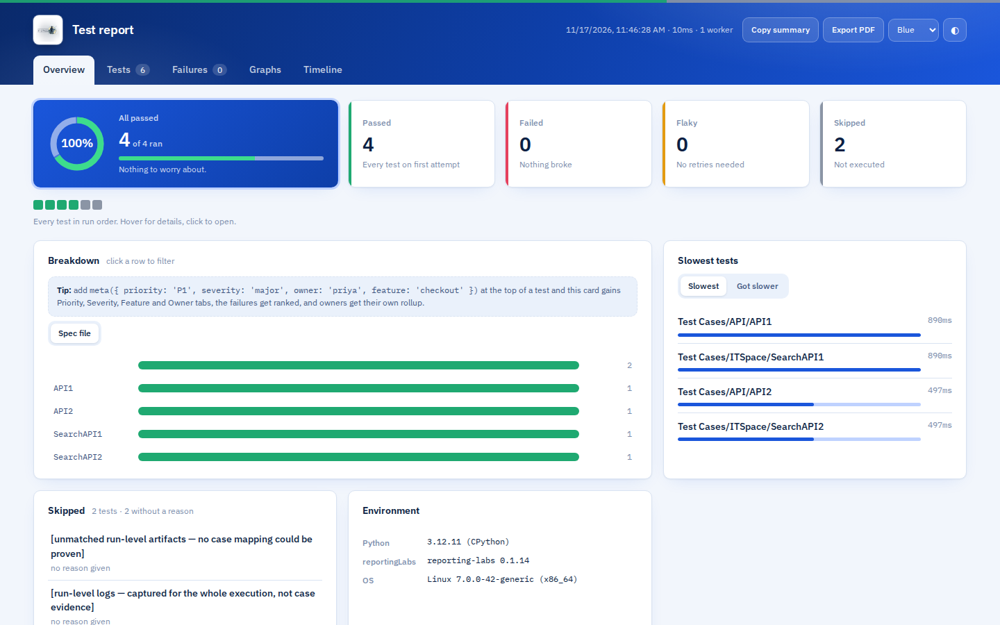

### 6.3 Evidence

The execution page lists retained **artifacts**: JUnit XML, Katalon
`execution.uuid`, execution/console logs, screenshots, HAR files,
native Katalon HTML/CSV reports, and (for live runs) the target run
log. **Download** options provide a report ZIP and an artifacts ZIP.

Evidence lives under managed directories owned by executions (see
Admin Manual §9). Deleting an execution removes only the evidence it
owns; evidence another execution also references is kept.

### 6.4 Troubleshooting missing or incomplete results

- No results table — the run failed before producing JUnit
  (activation or infrastructure failure); read the run log artifact.
- `rl_status=missing` — there were no stored results to report on.
- An imported execution with warnings — open its provenance and
  warnings; the missing files were missing at the source.

---

## 7. Fixture-vs-licensed statement for these screenshots

All screens in this manual come from the published 2.0.2 package on
Linux. Live-execution screens used a **fixture** KRE stand-in
emitting genuine Katalon-format output — they demonstrate dispatch,
registration, execution plumbing, result/evidence return, and report
generation, **not licensed KRE execution**. Licensed-KRE execution
requires a valid Katalon licence/API key on the target host and was not
validated in this environment. Imported-execution screens show
**real Katalon 11.7.0 output** produced by a licensed run elsewhere.
